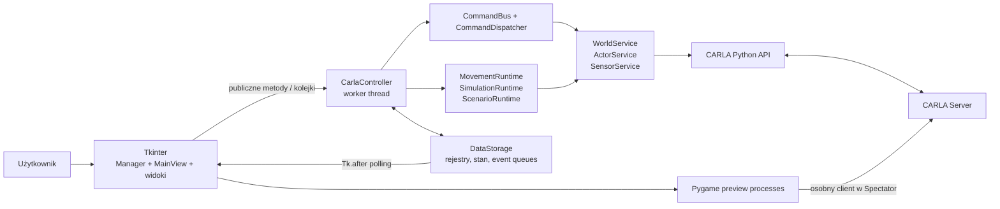
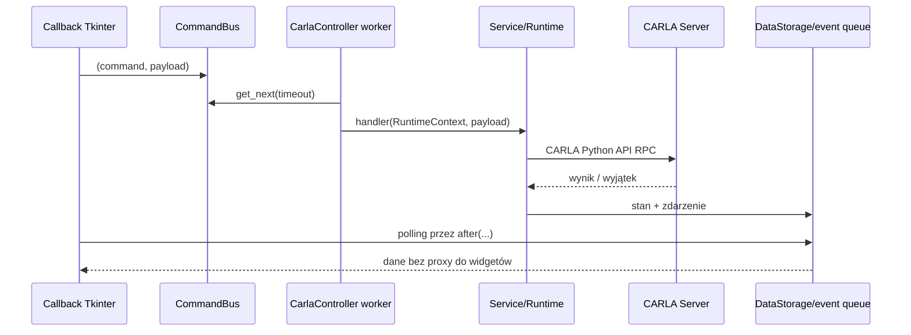
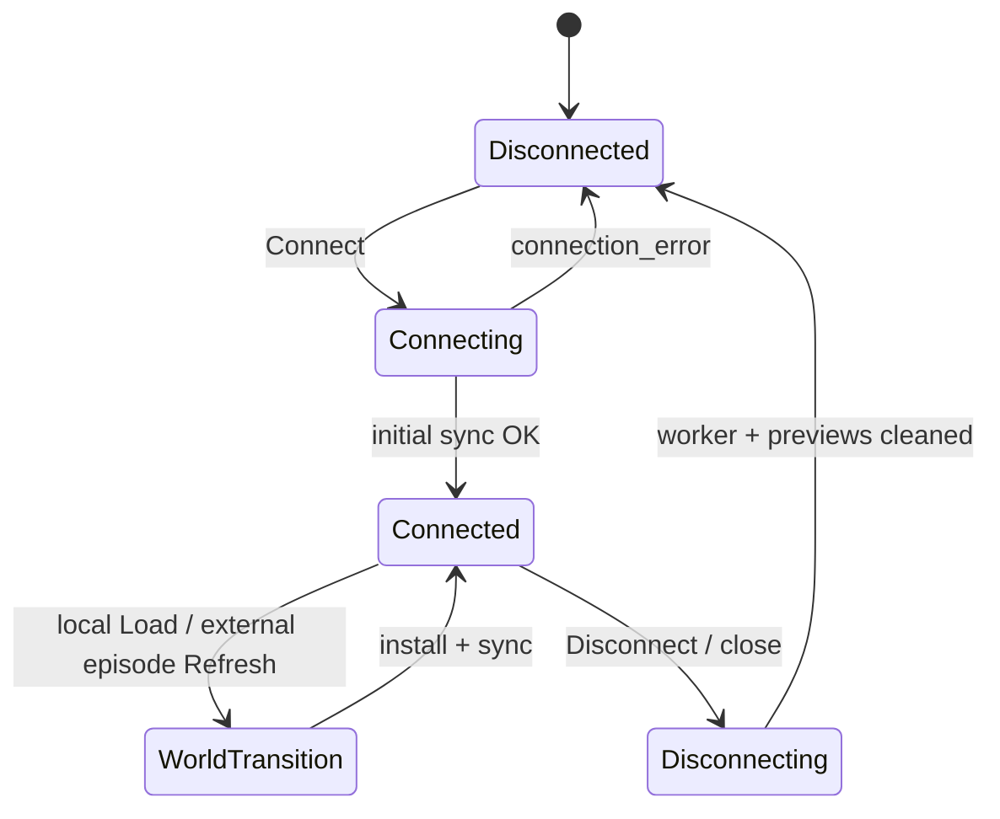

# Architektura CARLA Simulator Manager

## Zakres i źródło prawdy

Dokument opisuje bieżący kod roboczy przed manualnymi E2E. Punktem wejścia jest
`app.py`; nie należy wywodzić aktualnej architektury z raportów etapowych w
`docs/implementation/` ani `docs/architecture/legacy/`.

## Widok całości

Warstwy są rozdzielone odpowiedzialnością, lecz nie są hermetyczne. Kontroler
dziedziczy trzy klasy runtime i zachowuje część starszych handlerów bezpośrednio
w `core/controller.py`. Services nie tworzą klientów ani wątków; otrzymują
`RuntimeContext` i wykonują się w workerze kontrolera.

## Punkt wejścia i GUI

`app.main()` wywołuje `multiprocessing.freeze_support()`, tworzy
`gui.application.Manager` (`tk.Tk`) i uruchamia `mainloop()`. `Manager`:

- tworzy `DataStorage`, `MainView`, `SpectatorPreviewManager` i
  `MovementControlSession`;
- zestawia i kończy połączenie;
- odpytuje kolejki zdarzeń przez `after(...)`;
- tworzy widoki zależne od świata po Connect i niszczy je przy Disconnect lub
  pełnej odbudowie episode.

`gui.main_view.MainView` zawiera zakładki `Main View`, `World & Weather`,
`Actors`, `Sensors` i `Simulation Control`; `Actors` ma podzakładki `Vehicles`,
`Pedestrians` i `Static Objects`. Dashboard i Connection/Spectator controls są
w `gui/tabs/home.py` oraz `gui/widgets/dashboard.py`.

Tkinter nie jest aktualizowany z workera CARLA. Worker zapisuje stan lub emituje
zdarzenie, a główny wątek GUI odbiera je podczas pollingu.

Dialogi GUI pochodzą z `tkinter.messagebox` i są wywoływane wyłącznie przez
callbacki/polling głównej pętli Tk. Przenośna normalizacja scrolla obsługuje
`<MouseWheel>` oraz eventy X11 `<Button-4>/<Button-5>`. Dane generowane przez
aplikację, takie jak cache map, trafiają do per-user cache (`LocalAppData` albo
XDG/`~/.cache`), natomiast zasoby dostarczane z repozytorium są tylko czytane.

## `CarlaController` i runtime

`core.controller.CarlaController` dziedziczy z:

- `movement.runtime.MovementRuntime` — tryby sterowania, BasicAgent, Walker AI,
  Traffic Manager i Movement Preview;
- `simulation.runtime.SimulationRuntime` — ticki, stan Simulation Control i
  Dashboard;
- `scenarios.runtime.ScenarioRuntime` — Refresh, ownership, Save/Load i Clear.

`start()` uruchamia daemon thread z `run()`. `_run_controller()` tworzy
`carla.Client`, pobiera zasoby świata, synchronizuje inventory, a następnie
przetwarza kolejki. `RuntimeContext` przechowuje aktualne `client`, `database`,
`world` i `blueprint_library`; po zmianie mapy kontekst jest aktualizowany.

`CommandBus` zawiera zwykłą i priorytetową `queue.Queue`. Priorytet jest
sprawdzany przed kolejką zwykłą. `CommandDispatcher` rejestruje handlery usług
dla m.in. spawn, world/weather, actor transform oraz sensor lifecycle. Pozostałe
polecenia są routowane przez runtime albo kontroler.

## Services

| Moduł | Rzeczywista odpowiedzialność |
|---|---|
| `services/world.py` | pełny snapshot episode, `load_world()` z potwierdzeniem świeżego `get_world()`, instalacja cache świata |
| `services/actors.py` | bezpieczny lookup blueprintu, spawn, walidacja blueprintu i fizyki, remove/transform |
| `services/sensors.py` | attach/remove/transform, listener preview, rejestracja sensora i cleanup rodzica |
| `services/blueprints.py` | lookup blueprintu i stosowanie modyfikowalnych atrybutów |
| `services/weather.py` | utworzenie `WeatherParameters` i `world.set_weather()` |

`WorldService.capture()` pobiera `world_id`, mapę, `BlueprintLibrary`, listę
map, pogodę, spawn pointy i ustawienia zanim stan lokalny zostanie zmieniony.
`WorldService.install()` czyści rejestry runtime, zapisuje nowy świat i zwiększa
`world_generation`.

## `DataStorage` i modele

`core.state_store.DataStorage` jest pamięciowym store'em współdzielonym przez
GUI i worker, chronionym `threading.Lock`. Nie jest trwałą bazą danych. Zawiera:

- `Actors` i `Sensors` z `core/registries.py` oraz `ActorInfo`/`SensorInfo` z
  `models/actors.py`;
- referencję `World`, `world_id`, `world_generation`, blueprinty, pogodę,
  spawn pointy, listę map i ustawienia;
- stany vehicle/walker control, Simulation Control i Dashboard;
- kolejki zdarzeń aktorów, sensorów, symulacji, scenariuszy, movement i map;
- reconnect hints oraz identyfikatory infrastruktury mapy.

Stan serwera jest źródłem prawdy dla obiektów runtime. Store jest projekcją
wzbogaconą o dane GUI: logical name, ownership, origin, `scenario_id`, dane
fizyki i konfigurację. `runtime_id` CARLA nie jest trwałą tożsamością scenariusza.

## Ownership i klasyfikacja

`models.scenarios.ActorOwnership` rozróżnia:

- `managed` — utworzony/odtworzony przez GUI albo jawnie przejęty; można go
  mutować i zapisać;
- `external` — wykryty na serwerze, ale nieprzejęty;
- `internal` — techniczny aktor aplikacji, np. kamera preview.

`ActorClassifier` dodatkowo rozpoznaje `WORLD_INFRASTRUCTURE`. Synchronizacja
nie adoptuje obcych aktorów. `ActorAdopter` przed zmianą ownership porównuje
`world_id`, runtime ID, typ, parent, `role_name` i atrybuty, aby ograniczyć
ryzyko przejęcia obiektu po ponownym użyciu ID.

## Episode i `world_generation`

`world_id` jest ID episode zwracanym przez CARLA. `world_generation` jest
lokalnym, monotonicznie zwiększanym licznikiem instalacji/unieważnienia świata.
Para chroni przed stale references i późnymi zdarzeniami:

- komendy Movement zawierają ID i generację;
- raporty Refresh są znakowane obiema wartościami;
- GUI ignoruje raport niepasujący do bieżącego store'a;
- plan Load/Clear zawiera ID świata i jest ponownie walidowany przed wykonaniem;
- zmiana episode czyści rejestry, control state i reconnect hints.

## Synchronizacja świata

`scenarios.synchronization.WorldSynchronizer` odczytuje `world.get_actors()`,
klasyfikuje aktorów, aktualizuje istniejące rekordy, dodaje nowe jako External i
usuwa rekordy nieobecne. Pomija aktorów Internal oraz bazową infrastrukturę
mapy. Po Configuration Load istnieje ograniczona ochrona świeżo zarejestrowanych
Managed actors przed krótkim opóźnieniem inventory CARLA.

Zwykła synchronizacja nie instaluje nowej mapy, blueprint library ani settings.
Pełną odbudowę po zewnętrznej zmianie episode realizuje
`ScenarioRuntime._refresh_world_from_server()` wraz z `WorldService`.

## Synchronizacja, ticki i długie operacje

`SimulationManager` waliduje i stosuje `WorldSettings`, śledzi aktywność
lokalnego scheduler'a i decyduje, kiedy worker ma wywołać tick. W synchronous
mode tylko klient będący właścicielem sterowania tickami powinien je generować;
aplikacja nie koordynuje globalnego locka między klientami.

Długie RPC nie są wykonywane w wątku Tkinter, ale worker jest pojedynczy:
długie `load_world`, preflight, restore lub oczekiwanie na potwierdzenie destroy
opóźnia inne zwykłe polecenia. GUI pozostaje responsywne i pokazuje stan pending.
Operacje Configuration Management serializuje techniczny
`scenario_operation_lock` oraz tokeny planów. Zachowane nazwy `Scenario*` są
elementem wewnętrznego API i schematu zgodnego ze starszymi plikami.

## Podglądy i callbacki sensorów

- Sensor Preview korzysta z callbacków CARLA zapisujących do thread-safe
  buforów `preview/sensor_buffers.py`; Tkinter pobiera migawki.
- Movement Preview tworzy we właściwym episode kamerę RGB, a Pygame działa w
  procesie `spawn`; control queue przenosi dane wejściowe.
- Spectator Preview działa w osobnym procesie i tworzy własny `carla.Client`.
  Co sekundę sprawdza ID świata i kończy się po jego zmianie.

## Lifecycle połączenia

Connect tworzy nowy kontroler, a Disconnect zatrzymuje lokalne ticki,
Movement/Walker/preview, kontrolowany Traffic Manager, worker i tworzy nowy
`DataStorage`. Refresh po nowym episode nie tworzy nowego klienta ani store'a;
instaluje nowy świat w istniejącej sesji.

## Błędy i timeouty

- główny klient używa timeoutu 5 s; przy lokalnej zmianie mapy tymczasowo 30 s;
- `WorldService.load_with_retry()` wywołuje `load_world()` raz i odpytuje świeży
  `get_world()` do 10 razy z przerwą 1 s;
- zewnętrzny Refresh pobiera kompletny snapshot i maksymalnie trzy razy
  potwierdza stabilne ID episode przed instalacją;
- błędy trafiają do kolejek GUI i Dashboardu; nie każdy wyjątek powoduje
  automatyczny reconnect;
- operacje destrukcyjne raportują częściowy sukces; Scenario Replace nie ma
  transakcyjnego rollbacku po rozpoczęciu clear/spawn.

Szczegóły RPC: [CARLA_COMMUNICATION.md](CARLA_COMMUNICATION.md). Funkcjonalności:
[GUI_FUNCTIONALITIES.md](GUI_FUNCTIONALITIES.md).
