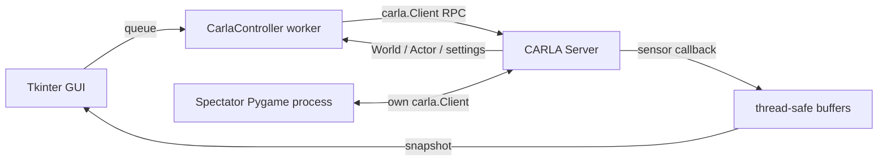
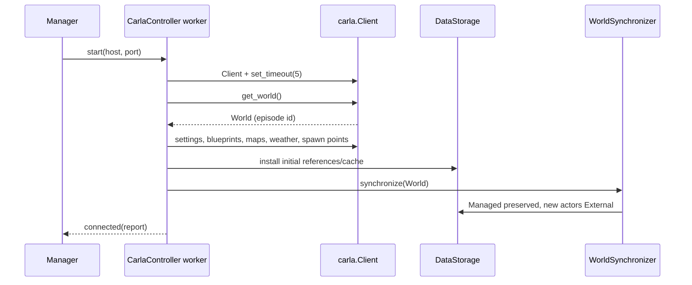
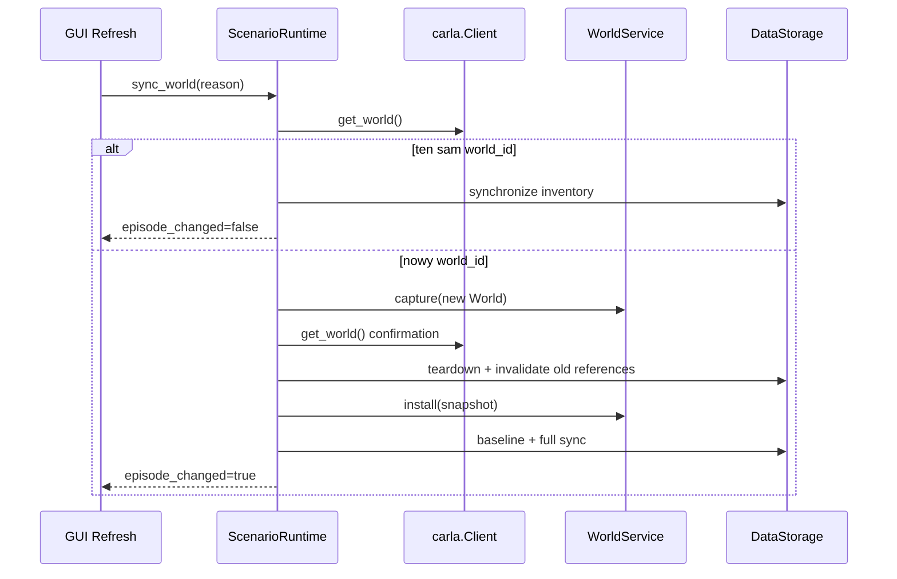

# Komunikacja z CARLA

## Model klient–serwer

CARLA Simulator działa jako serwer symulacji. Aplikacja jest klientem Python API:
wysyła RPC dotyczące świata, aktorów i ustawień, a sensory przekazują dane przez
callbacki. Główny `carla.Client` należy do workera `CarlaController`. Spectator
Preview jest wyjątkiem: jego proces tworzy własnego klienta.

## Connect

`Manager.connect_to_carla()` tworzy `CarlaController(database, callback, host,
port)`. Formularz domyślnie używa `127.0.0.1:2000` i waliduje port 1–65535.
`CarlaController._run_controller()` wykonuje:

1. `carla.Client(host, port)` i `client.set_timeout(5.0)`;
2. `client.get_world()` oraz odczyt `world.id`;
3. `world.get_settings()` przez `SimulationManager`;
4. `world.get_blueprint_library()`;
5. `world.get_weather()`, `client.get_available_maps()` i
   `world.get_map().get_spawn_points()`;
6. zapis cache do `DataStorage` i zwiększenie `world_generation`;
7. reset Dashboardu i initial sync przez `WorldSynchronizer`;
8. publikację `("connected", report)` w `connection_queue`.

Błąd dowolnego etapu publikuje `connection_error`. Timeout nie jest ustawiany w
GUI. Connection Manager obsługuje zarówno loopback, jak i adres LAN/DNS; serwer,
routing i firewall pozostają poza zakresem aplikacji.

## `World`, `Map` i `BlueprintLibrary`

- `carla.World` reprezentuje konkretny episode; proxy starego episode może
  zgłaszać błąd po `load_world()`.
- `world.get_map()` dostarcza nazwę i spawn pointy.
- `world.get_blueprint_library()` jest cache'owana dla bieżącego episode.
- `client.get_available_maps()` zwraca identyfikatory serwera. Kod nie zakłada,
  że 0.9.15 i 0.9.16 zwracają identyczną postać ścieżki.

`utilities.map_names` porównuje krótką i pełną nazwę bez utożsamiania dwóch
różnych pełnych ścieżek. Niejednoznaczny basename jest błędem. `EmptyMap` jest
filtrowana wyłącznie z listy GUI przez końcowy segment nazwy.

`WorldService.load_with_retry()` wywołuje `client.load_world(map_name)` raz,
ignoruje potencjalnie stale proxy zwrócony przez tę metodę, a następnie odpytuje
`client.get_world()` i potwierdza mapę. Domyślnie wykonuje do 10 odczytów z
przerwą 1 s. Standardowa zmiana mapy tymczasowo ustawia timeout klienta na 30 s,
a w `finally` przywraca 5 s.

## Actor API

`ActorService` używa `BlueprintLibrary.find()`, ustawia modyfikowalne atrybuty i
wywołuje `try_spawn_actor()` albo `spawn_actor()`. Weryfikuje, czy utworzony
`type_id` odpowiada żądaniu. Dla pieszego po `None` z `try_spawn_actor()` istnieje
jedna próba z Z zwiększonym o 2 m; nie ma losowego przenoszenia ani pętli retry.

Operacje edycji korzystają m.in. z `Actor.set_transform()`,
`Vehicle.apply_physics_control()` i `Actor.destroy()`. Aplikacja przechowuje
referencje runtime tylko dla aktywnego episode i wiąże je z `world_id`.

`WorldSynchronizer` pobiera `world.get_actors()`, aktualizuje rekordy, dodaje
nieznane obiekty jako `External` i usuwa stale rekordy. Synchronizacja inventory
nie jest pełnym przeładowaniem świata.

## Sensor API

`SensorService` tworzy sensor przez `world.spawn_actor(blueprint, transform,
attach_to=parent, attachment_type=...)`. Transform jest względny wobec parenta
dla sensora attached. Obsługiwane nazwy mocowania są jawnie mapowane do
`carla.AttachmentType`: `Rigid`, `SpringArm`, `SpringArmGhost`. Brak wartości w
aktywnym API kończy operację błędem, bez fallbacku.

`sensor.listen(callback)` nie aktualizuje Tkintera. Callback zapisuje dane do
bufora, a okno GUI pobiera snapshot. Cleanup kolejno zatrzymuje listener i
niszczy sensor należący do aplikacji. Usunięcie lub Change Model parenta usuwa
jego sensory; Change Model nie odtwarza ich automatycznie.

## Pogoda i `WorldSettings`

`services.weather.apply_weather()` pobiera świeży świat, tworzy
`carla.WeatherParameters` z wartości GUI i wywołuje `world.set_weather()`.
Lista presetów jest uzyskiwana dynamicznie z rzeczywistych instancji
`WeatherParameters`, dlatego nie zakłada identycznego zestawu v15/v16.

`SimulationManager` odczytuje i waliduje pola:

- `synchronous_mode`;
- `fixed_delta_seconds`;
- `no_rendering_mode`;
- `substepping`;
- `max_substep_delta_time`;
- `max_substeps`.

Po `world.apply_settings()` stan jest ponownie publikowany do GUI. Configuration Save
zapisuje te pola, a Load próbuje je zastosować po przygotowaniu świata.

## Synchronous, asynchronous i ticki

W asynchronous mode serwer sam rozwija symulację. W synchronous mode świat
czeka na tick klienta. `SimulationManager` rozróżnia stan ustawień od lokalnej
aktywności scheduler'a. Worker skraca timeout kolejki do zera, gdy powinien
wykonać tick, dzięki czemu `SimulationRuntime` może wywołać `world.tick()` bez
blokowania Tkintera. Single Step wykonuje pojedynczy krok; Pause/Resume zmieniają
lokalną politykę ticków.

Aplikacja nie zapewnia rozproszonego arbitra między klientami. Przy wielu
klientach dokładnie jeden powinien świadomie sterować tickami. Obserwator może
odczytywać snapshoty, lecz równoległe `tick()` z kilku klientów jest błędną
konfiguracją środowiska.

## Trzy znaczenia „Refresh”

### 1. Odświeżenie inventory

`Refresh World` wywołuje `client.get_world()`. Jeżeli `world.id` jest zgodne z
`DataStorage.world_id`, `ScenarioRuntime._perform_world_sync()` aktualizuje tylko
aktorów/sensory i raport. Nie resetuje ownership, sterowania, GUI ani cache mapy.

### 2. Nowy episode i pełna odbudowa

Jeżeli ID jest inne, `_refresh_world_from_server()` uruchamia External World
Refresh:

1. `WorldService.capture()` pobiera kompletny snapshot nowego episode.
2. Drugi `get_world()` potwierdza ID; przy kolejnej zmianie odczyt jest ponawiany
   maksymalnie trzy razy.
3. Zatrzymywane są lokalne ticki, sterowanie, Walker AI, listenery i preview.
4. Plany Load/Clear i proxy starego episode są unieważniane.
5. Czyszczone są rejestry i reconnect hints; `world_generation` rośnie.
6. `WorldService.install()` instaluje snapshot i ponownie zwiększa generację.
7. Odbudowywane są infrastruktura, Dashboard i inventory.
8. Aktorzy nowego świata są `External`; Managed actors starego świata nie są
   automatycznie odtwarzane.
9. GUI zamyka Movement/Spectator i ponownie tworzy zakładki zależne od świata.

Nie jest to Clear World ani reconnect transportu RPC.

### 3. Disconnect/Reconnect

Disconnect zatrzymuje worker i zasoby lokalne, a `Manager` tworzy nowy
`DataStorage`. Reconnect tworzy nowy `CarlaController` i nowy `carla.Client`.
Reconnect jest cięższy od Refresh i traci lokalny store; reconnect hints mogą
zachować ownership tylko po ścisłym dopasowaniu tożsamości tego samego episode.

## `world_id`, `world_generation` i stale references

`world_id` pochodzi z CARLA i zmienia się przy każdym nowym episode, także po
reloadzie tej samej mapy. `world_generation` jest lokalnym licznikiem
unieważnienia/instalacji. Sama nazwa mapy nie jest identyfikatorem świata.

## Procesy preview na Windows i Linux

Movement Preview i Spectator Preview jawnie korzystają z kontekstu
`multiprocessing.get_context("spawn")`; aplikacja nie zależy od domyślnego
linuksowego `fork`. Cele procesów są funkcjami na poziomie modułu, a `app.py`
zawiera guard `__main__` i `freeze_support()`. Nieudany `Process.start()` zwalnia
utworzone kolejki i uchwyty. Błąd importu Pygame lub utworzenia display jest
raportowany przez event queue, po czym proces wykonuje cleanup. Zamknięcie
Movement Preview kończy kamerę podglądu, ale nie zmienia aktywnego Free Roam ani
Destination.

Raporty sync, Movement session i polecenia preview zawierają token świata. GUI
porównuje go z bieżącym store'em. Plan preflight zawiera `world_id`, digest pliku
i token; wykonanie ponownie odczytuje plik oraz waliduje świat. Chroni to przed:

- ponownym użyciem Actor ID w nowym episode;
- opóźnionym eventem z poprzedniej generacji;
- wykonaniem planu Clear/Load na innym świecie;
- użyciem starej kamery, waypointu, agenta lub `BlueprintLibrary`.

## Traffic Manager i wielu klientów

Domyślnie aplikacja wybiera Exclusive TM na porcie `8050`. Przed
`get_trafficmanager()` sprawdza lokalną dostępność portu i rejestruje ownership w
procesie. Tylko tak potwierdzona instancja może otrzymać `shut_down()` lub zmianę
synchronous mode. Druga instancja GUI powinna używać np. `8051`.

Shared TM (`CARLA_MANAGER_TM_EXCLUSIVE=0`, domyślny port `8000`, jeżeli port nie
jest nadpisany) nie jest zatrzymywany ani rekonfigurowany. Lokalna zmiana mapy
może zostać odrzucona, jeżeli aktywny shared proxy wymagałby niebezpiecznego
teardownu. Po zewnętrznej zmianie episode proxy jest tylko unieważniany.

## Utrata połączenia i błędy

Wyjątek workera uruchamia best-effort cleanup, unieważnia referencję świata,
zatrzymuje lokalny scheduler i publikuje `connection_error`. Nie ma automatycznej
pętli reconnect. Użytkownik wykonuje Disconnect/Reconnect. Błąd snapshotu przed
External World Refresh pozostawia stary stan bez częściowej instalacji; nie
oznacza to jednak, że stary proxy nadal jest użyteczny po zmianie serwera.

Manualne przypadki timeoutów i utraty serwera są nadal oczekujące — patrz
[TESTING.md](TESTING.md).
