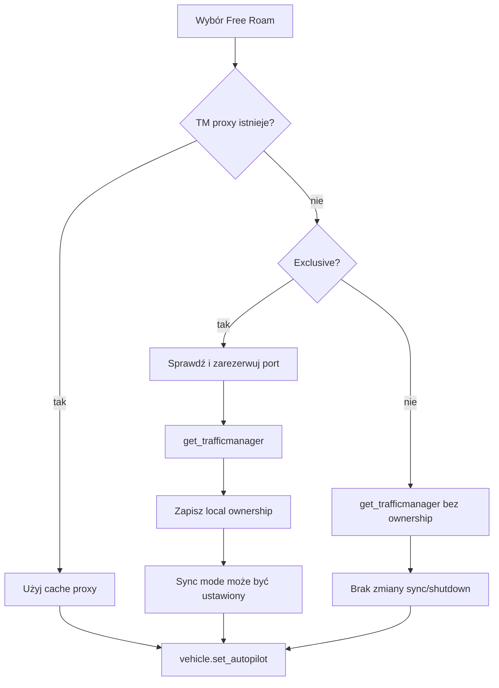

# Movement Control

## Komponenty i zakres

Movement Control działa dla jednego wybranego `Managed` vehicle albo walker w
danej sesji okna. `External` musi najpierw przejść `Take Ownership`.

| Moduł | Rola |
|---|---|
| `movement/session.py` | lifecycle jednej sesji GUI, event polling i token świata |
| `gui/windows/movement_control.py` | widgety sterowania, cel, prędkość i mapa |
| `movement/runtime.py` | wykonanie w workerze: manual, TM, agent, Walker AI |
| `movement/destination.py` | walidacja celu i waypoint snapshots |
| `movement/vehicle.py`, `walker.py` | nazwy trybów i początkowy state |
| `preview/movement.py` | proces Pygame, frame publisher i input smoothing |
| `gui/widgets/navigation_map.py` | wybór celu na obrazie mapy |

Polecenia zawierają `session_id`, `world_id` i `world_generation`. Worker i GUI
odrzucają stale eventy po zmianie actor/world/session.

## Podgląd Pygame

Otwarcie Movement Control uruchamia osobny proces Pygame i zleca workerowi
utworzenie `sensor.camera.rgb` przypiętego do aktora przez
`AttachmentType.Rigid`. Domyślna konfiguracja kamery to 800×450, FOV 90 i 30
Hz. Callback publikuje najnowszą klatkę do procesu; input manualny wraca przez
control queue.

Okno Pygame jest skalowalne (`RESIZABLE`) z minimalnym rozmiarem 480×270.
Zmiana rozmiaru nie odtwarza sensora i nie zmienia jego rozdzielczości 800×450.
Ostatnia klatka jest dopasowywana metodą fit/contain: zachowuje proporcje, jest
wyśrodkowana, a letterbox ma ciemne tło. Przeskalowana powierzchnia jest
cache'owana do czasu nadejścia nowej klatki albo kolejnego resize.

Worker publikuje również ograniczoną do 10 Hz telemetrię bieżącego aktora.
Session manager przekazuje najnowszy pakiet do istniejącego procesu przez
jednoelementową kolejkę. Półprzezroczysty HUD pokazuje tryb, rzeczywistą prędkość,
bieg oraz throttle/brake/steering z `actor.get_control()`. `H` przełącza
widoczność nakładki. HUD jest rysowany osobno po przeskalowaniu obrazu, pozostaje
zakotwiczony w lewym górnym narożniku i nie jest rozciągany wraz z kamerą. Nie
powstaje dodatkowy klient CARLA ani proces.

Kamera ma origin Internal i nie trafia do Save/Clear Managed. Zmiana presetu
zmienia relative transform. Cleanup zamyka publisher, zatrzymuje listener,
niszczy kamerę i publikuje event zakończenia. Przy ścisłym cleanupie błąd może
zatrzymać zmianę mapy, aby nie kontynuować ze stale proxy.

## Vehicle Manual Control

Tryb `Manual Control` używa `carla.VehicleControl`. Input jest wygładzany w
preview i okresowo stosowany w workerze (docelowo 20 Hz). Obsługiwane są
throttle, brake, steering, handbrake i reverse. Timeout świeżości inputu wynosi
0,5 s; brak nowych danych nie powinien utrzymywać niekontrolowanie starej
komendy.

Przejście do Manual wyłącza autopilot i kończy aktywny executor Destination dla
tego pojazdu. Zamknięcie samego okna kończy manual input/camera session.

## Free Roam

`Autopilot - Free Roam` wywołuje `vehicle.set_autopilot(True, tm_port)` i używa
Traffic Managera. Nie ma wybranego celu. Przejście z Destination usuwa agent lub
diagnostyczny plan i dopiero potem włącza TM. `No Control` wyłącza autopilot,
zatrzymuje lokalny runtime i ustawia neutralny control.

## Destination dla pojazdu

### Wybór celu

GUI pobiera mapę OpenDRIVE oraz bieżącą pozycję. Cel może zostać wskazany na
mapie lub współrzędnymi. `validate_vehicle_destination()` mapuje go na drogowy
waypoint, może skorygować punkt i zwraca status. Dopiero Confirm zapisuje cel w
`DataStorage`. Cel jest związany z konkretnym actor ID i world ID.

### `BasicAgent` — domyślny executor

Brak `CARLA_MANAGER_DESTINATION_EXECUTOR` wybiera `basic_agent`. Worker:

1. ładuje `agents.navigation.basic_agent.BasicAgent` z oficjalnego PythonAPI;
2. używa `GlobalRoutePlanner` do planu `(Waypoint, RoadOption)`;
3. wyłącza TM autopilot dla pojazdu;
4. cyklicznie wywołuje `agent.run_step()` i `vehicle.apply_control()`;
5. śledzi odległość, postęp, aktualny waypoint i stall;
6. hamuje i kończy stanem Arrived/Stuck/Failed/Cancelled.

Agent działa w workerze, nie w Tkinterze ani procesie Pygame. `path` i `route`
pozostają diagnostycznymi executorami Traffic Managera wybieranymi zmienną
środowiskową; nie są aktualnym domyślnym mechanizmem nawigacji.

### Prędkość i Adaptive Speed

GUI przyjmuje Maximum speed 10–90 km/h (domyślnie 40) i boolean Adaptive Speed.
Ustawienia należą do konkretnego runtime Destination. Podczas aktywnej jazdy są
zablokowane i pozostają widoczne po zamknięciu/ponownym otwarciu okna.

Wskaźnik Current speed prezentuje rzeczywistą długość wektora velocity CARLA po
przeliczeniu z m/s na km/h (`× 3.6`). Konwersja dotyczy wyłącznie prezentacji;
wewnętrzne sterowanie i dane CARLA pozostają w dotychczasowych jednostkach.
Odczyt nie zależy od trybu: Manual, Free Roam i Destination korzystają z tego
samego okresowego pakietu telemetrii aktora.

Adaptive Speed jest heurystyką geometrii 2D planu. Wyznacza profil prędkości na
łukach, ogranicza tempo zmian i przekazuje target speed agentowi. Nie zastępuje
logiki awaryjnej BasicAgent i nie modeluje przyczepności. Nie gwarantuje
utrzymania pasa ani bezpieczeństwa wobec wszystkich przeszkód.

## Pedestrian Manual

Tryb `Manual` normalizuje wektor X/Y, waliduje speed 0,1–10,0 m/s i stosuje
`carla.WalkerControl`. Przejście do Manual zatrzymuje runtime Random/Destination.
Kierunek nie może być zerowy. Stan zapisuje ostatni kierunek i prędkość.

## Walker AI — Random

`Automatic - Random Walk` tworzy blueprint `controller.ai.walker`, przypina go
do walkera, uruchamia `start()`, wybiera cel przez
`world.get_random_location_from_navigation()` i ustawia `set_max_speed()`.
Runtime monitoruje controller i może wybierać kolejne cele. Stop/cleanup wywołuje
`stop()` i `destroy()` technicznego controllera.

## Walker Destination

Cel pieszego jest walidowany względem navigation location i wiązany z actor/world.
`Automatic - Destination` próbuje użyć `controller.ai.walker` z
`go_to_location()` i speed. Runtime monitoruje postęp. Jeżeli AI nie rusza,
istnieje ograniczony fallback bezpośredniego `WalkerControl` w stronę celu.
Terminalne stany to Arrived, Stuck, Failed i Cancelled.

## Zachowanie po zamknięciu okna

Zamknięcie Movement Control:

- zatrzymuje Movement Preview i manual input session;
- nie anuluje automatycznie aktywnego vehicle Destination;
- nie wyłącza automatycznie Free Roam;
- nie musi zatrzymać aktywnego Walker AI/Destination;
- pozwala ponownie otworzyć okno i odczytać state z `DataStorage`.

Automatyczne sterowanie kończy jawna zmiana trybu, terminalny wynik, usunięcie
aktora, Clear/Load, zmiana episode, Disconnect lub błąd runtime.

## Traffic Manager: Shared i Exclusive

### Konfiguracja

| Zmienna | Domyślnie | Znaczenie |
|---|---|---|
| `CARLA_MANAGER_TM_EXCLUSIVE` | włączone | aplikacja wymaga własności instancji |
| `CARLA_MANAGER_TM_PORT` | `8050` w Exclusive | zarezerwowany port tej instancji |
| shared default | `8000` | używany, gdy Exclusive wyłączono i portu nie podano |

### Exclusive

Przed `client.get_trafficmanager(port)` kod sprawdza lokalnie, czy port jest
wolny, oraz rejestruje ownera w procesie. Dopiero proxy utworzony w tym
kontrakcie otrzymuje flagę ownership. Tylko taki TM może:

- otrzymać `set_synchronous_mode()` zgodnie z WorldSettings;
- zostać zakończony przez `shut_down()` przy world transition/Disconnect;
- zostać bezpiecznie odtworzony w nowym episode.

Port `8050` nie może być jednocześnie używany przez inną instancję. Drugi GUI
powinien dostać np. `8051`. Kontrola lokalnego socketu nie jest globalnym
protokołem między hostami; administracyjne przypisanie portów nadal jest
wymagane.

### Shared

W Shared ownership jest nieznane. Aplikacja:

- nie wywołuje `shut_down()`;
- nie zmienia synchronous mode TM;
- tylko przekazuje port do `set_autopilot()`;
- unieważnia lokalny proxy po zewnętrznym world change.

Lokalna zmiana mapy może być celowo zablokowana, jeżeli aktywny shared TM
wymagałby zatrzymania bez prawa własności. Ma to chronić innych klientów.

## Lifecycle i cleanup

Przy zmianie mapy/episode, Disconnect, Clear lub usunięciu aktora cleanup może
obejmować:

1. zatrzymanie BasicAgent i usunięcie planów;
2. `set_autopilot(False, port)` dla lokalnie kontrolowanych vehicles;
3. stop/destroy Walker AI controllers;
4. neutralny `VehicleControl`/`WalkerControl`, zależnie od ścieżki;
5. stop/destroy Movement RGB camera i procesu Pygame;
6. Exclusive TM `shut_down()` tylko z potwierdzonym ownership;
7. wyczyszczenie state/runtime i tokenów starej generacji.

External World Refresh wykonuje best-effort cleanup starych proxy, ponieważ
serwer mógł już usunąć episode. Lokalna zmiana mapy używa ścisłego cleanupu i
może zostać anulowana, jeśli nie można bezpiecznie zakończyć zasobu.

## Ograniczenia

- rzeczywiste zachowanie BasicAgent, TM i NavMesh zależy od mapy, wersji CARLA i
  ruchu innych klientów;
- wielu klientów nie może bez koordynacji sterować tym samym aktorem;
- synchronous world wymaga jednego świadomego tick mastera;
- zamknięcie GUI nie jest poleceniem zatrzymania ruchu automatycznego;
- executory `path`/`route` są diagnostyczne i nie powinny być opisywane jako
  docelowa implementacja;
- Adaptive Speed i fallback walkera wymagają manualnej oceny w E2E.
