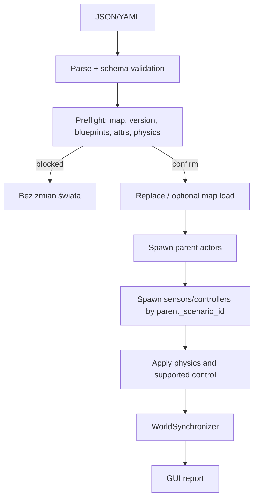

# Configuration Management

## Zakres

Configuration Management zapisuje i odtwarza konfigurację środowiska symulacji
zarządzaną przez GUI. Nie jest to pełny scenariusz testowy, snapshot pamięci
Unreal Engine, nagranie symulacji ani gwarancja deterministycznego replay.
Określenia `Scenario*` pozostają w nazwach technicznych i schemacie pliku dla
kompatybilności wstecznej.

Główne moduły:

| Moduł | Odpowiedzialność |
|---|---|
| `scenarios/manager.py` | fasada Save, preflight i execute Load |
| `capture.py` | odczyt świata i budowa `ScenarioDocument` |
| `serialization.py` | JSON/YAML, digest i zapis atomowy |
| `validation.py` | walidacja schematu i danych |
| `loader.py` | niedestrukcyjny preflight i kolejność zależności |
| `restorer.py` | Replace, map change, spawn i raport Load |
| `cleaner.py` | plany Clear/Replace, walidacja tożsamości i destroy |
| `synchronization.py` | inventory CARLA ↔ `DataStorage` |
| `classifier.py`, `adoption.py` | kategoria, ownership i jawna adopcja |
| `scenarios/runtime.py` | serializacja poleceń i lifecycle w workerze |

## Format pliku

`ScenarioSerializer` obsługuje JSON oraz YAML (`.yaml`/`.yml`). JSON jest
zapisywany UTF-8 z wcięciem i bez `NaN`; YAML używa `yaml.safe_dump`/`safe_load`.
Zapis jest atomowy: plik tymczasowy w katalogu docelowym, `fsync`, a następnie
`os.replace`. Katalog docelowy musi istnieć.

Schemat ma stałe:

```text
schema: carla-simulator-manager/scenario
schema_version: 1
```

Uproszczona struktura:

```yaml
schema: carla-simulator-manager/scenario
schema_version: 1
metadata:
  name: "Nazwa"
  created_at: "2026-11-13T12:00:00Z"
  carla_version: "0.9.16"
  application_version: null
world:
  map: "/Game/Carla/Maps/Town01"
  captured_world_id: 42
  weather: { ... }
  simulation: { ... }
actors:
  - scenario_id: "uuid"
    captured_runtime_id: 101
    user_name: "Ego"
    category: "vehicle"
    blueprint_id: "vehicle..."
    origin: "gui_spawned"
    ownership: "managed"
    transform: { ... }
    blueprint_attributes: { role_name: "hero" }
    physics: { ... }
    control: { ... }
    parent_scenario_id: null
    attachment_type: null
    data_sources: { ... }
    completeness:
      status: "complete"
      missing_fields: []
      warnings: []
capture_report: { ... }
```

`captured_runtime_id` jest diagnostyczny. Relacje trwałe używają UUID
`scenario_id` i `parent_scenario_id`, ponieważ Actor ID zmienia się po respawnie.

## Save Configuration

`ScenarioManager.save()`:

1. normalizuje ścieżkę i format;
2. wykonuje `_perform_world_sync(reason="before_save")`;
3. pobiera `client.get_server_version()`; brak wersji przerywa Save zamiast
   zapisania fałszywej wartości;
4. `ScenarioCapture.capture()` odczytuje aktorów, mapę, pogodę i settings;
5. `ScenarioValidator.validate()` sprawdza dokument;
6. serializer zapisuje plik atomowo;
7. GUI otrzymuje raport zapisanych, pominiętych, częściowych i błędnych pozycji.

Capture zapisuje dokładną nazwę `world.get_map().name`, pogodę i pola
`WorldSettings`. Dla vehicle próbuje odczytać bieżące `VehiclePhysicsControl`,
w tym koła i krzywe; pozycja koła jest informacją diagnostyczną i nie jest
stosowana podczas restore. `role_name` zachowuje informację Ego dla każdego
pojazdu osobno.

Sensor zapisuje relative transform, `parent_scenario_id`, blueprint attributes i
`attachment_type`. Dla starszych plików brak attachment oznacza podczas Load
`Rigid`.

## Dlaczego tylko zakres Managed

Save obejmuje wyłącznie aktorów jednoznacznie należących do zakresu GUI:

- `Managed` utworzony przez GUI;
- `Managed` odtworzony przez Configuration Load;
- `External` dopiero po udanym `Take Ownership`.

Pomijane są:

- `External` należące do innych klientów;
- `Internal` kamery ghost, Movement/Spectator preview i techniczne sensory;
- infrastruktura świata rozpoznana względem baseline mapy;
- kategorie nieobsługiwane;
- runtime-only/unrestorable oraz zależności bez zapisywalnego parenta.

To ograniczenie zapobiega nieuprawnionemu przejmowaniu konfiguracji innych
klientów i obietnicy odtworzenia danych, których GUI nigdy nie znało. CARLA API
nie udostępnia też atomowego snapshotu świata przy aktywnych klientach; raport
Capture jawnie zawiera to ostrzeżenie.

## Walidacja

`ScenarioValidator` sprawdza m.in.:

- schema/version, metadata i wymagane typy;
- niepustą mapę, weather i wszystkie pola simulation;
- UUID `scenario_id`, globalną unikalność ID i logical names;
- kategorie, ownership, transformy i skończone liczby;
- istnienie parenta, brak cykli i poprawną zależność kategorii;
- physics/control/completeness i zgodność `capture_report` z liczbą aktorów.

Nieznane lub niekompletne pola krytyczne blokują Load. Wartości opcjonalne mogą
dać warning. Parser YAML używa safe loadera.

## Preflight Load Configuration

`ScenarioLoader.prepare()` jest obserwacyjny i nie mutuje CARLA. Odczytuje plik
wraz z SHA-256, waliduje dokument, filtruje zakres i tworzy
`ScenarioLoadPlan` z tokenem, `world_id`, digestem, target/current map oraz
raportem każdego aktora.

Preflight:

- rozwiązuje mapę względem `client.get_available_maps()`;
- porównuje wersję zapisu i serwera; sama różnica v15/v16 jest warningiem;
- sprawdza blueprint i modyfikowalne/read-only/nieznane atrybuty;
- klasyfikuje pola fizyki jako restorable/read-only/unverified;
- sprawdza attachment type i wymagane zależności;
- wyznacza topologiczną kolejność parent → sensor/controller;
- zwraca `ready`, `warning`, `unverified` albo `blocked`.

Przed wykonaniem Restorer ponownie przygotowuje plan, porównuje digest pliku,
token, `world_id` i kluczowe dane. Zmiana świata lub pliku unieważnia preflight.

## Polityka Replace

Load wymaga jawnego potwierdzenia. Jeżeli mapa jest inna, aktywowany jest nowy
world przez wspólny `WorldService.load_with_retry()`; stary episode znika po
stronie serwera. Jeżeli mapa jest już aktywna, wykonywany jest selective Replace.

Selective Replace usuwa:

- pojazdy i pieszych objęte polityką planu;
- Managed static objects;
- sensory i Walker AI controllers zależne od usuwanych parentów.

Chroni:

- infrastrukturę mapy;
- External static objects;
- External Ego vehicles;
- aktorów Internal.

Pozostałe kwalifikujące External dynamic actors mogą zostać usunięte zgodnie z
planem Replace; plan i ostrzeżenie są pokazywane przed destrukcją. Aplikacja nie
adoptuje ich. Zależny External child może zostać kaskadowo zniszczony przez CARLA
razem z parentem i jest raportowany.

Plan Clear zapisuje pełną tożsamość aktora. Przed `destroy()` sprawdzane są
episode, type, parent, `role_name` i atrybuty oraz nowe dzieci. Stale plan jest
odrzucany.

## Odtwarzanie



`ScenarioRestorer` tworzy aktorów w topologicznej kolejności. Rejestruje je jako
`Managed`/`scenario_loaded` z ID aktywnego świata. Dla sensora przekazuje parent,
relative transform i attachment. Vehicle physics jest stosowana pole po polu w
zakresie aktywnego API. Wynik zawiera mapowanie scenario ID na nowe runtime IDs.

Control state jest odtwarzany zachowawczo:

- Free Roam może ponownie włączyć autopilot, jeżeli zapisane dane są wystarczające;
- aktywny Destination nie jest rekonstruowany jako identyczny przebieg;
- walker state bez jawnego celu pozostaje zatrzymany z warningiem;
- zapisany `controller.ai.walker` z celem i prędkością może zostać uruchomiony.

## Clear Managed i Clear Entire World

`Clear Managed` planuje usunięcie Managed actors i ich zależności, zachowując
External, Internal i infrastrukturę. `Clear Entire World` jest jawnie
destrukcyjny: obejmuje także kwalifikujące External actors, ale nadal chroni
infrastrukturę i Internal. Nie należy uruchamiać go na współdzielonym serwerze
bez koordynacji.

Oba tryby mają preflight, token, potwierdzenie tożsamości, kolejność child przed
parent, timeout potwierdzenia zniknięcia i raport `success`, `partial_success`
albo `failed`.

## Kompatybilność 0.9.15/0.9.16

- pełna i krótka nazwa mapy są rozwiązywane względem listy docelowego serwera;
- różnica `metadata.carla_version` jest warningiem, nie dowodem niezgodności;
- brak mapy, blueprintu, modyfikowalnego atrybutu albo AttachmentType jest realną
  niezgodnością i może blokować;
- pola fizyki zależne od wersji są sprawdzane i raportowane;
- stary plik schema v1 z krótką mapą lub bez `attachment_type` jest obsługiwany
  bez migracji schematu.

Kompatybilność cross-version istnieje tylko dla przecięcia zasobów i kontraktów
obu serwerów. Nie została jeszcze potwierdzona pełnymi manualnymi E2E.

## Ograniczenia powtarzalności

Load odtwarza konfigurację, a nie identyczny stan dynamiczny. Nie gwarantuje:

- tych samych runtime IDs, klatek ani kolejności eventów;
- identycznej trajektorii, ruchu TM/BasicAgent lub zachowania NPC;
- atomowego snapshotu przy wielu klientach;
- identycznych kolizji, losowości, sensor timestamps lub obciążenia renderera;
- rollbacku po rozpoczęciu Replace;
- dostępności tych samych blueprintów i pól między wersjami.

Do porównywania scenariuszy należy używać logical/scenario IDs i konfiguracji,
nie Actor ID ani bitowej równości przebiegu.
