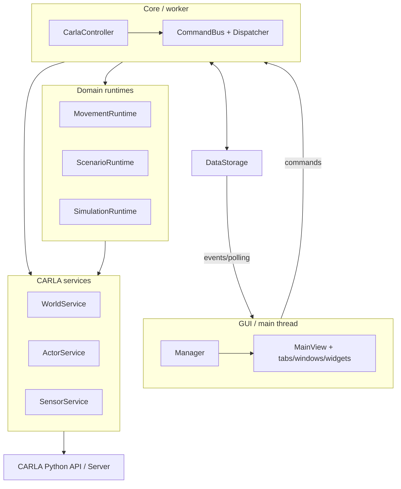
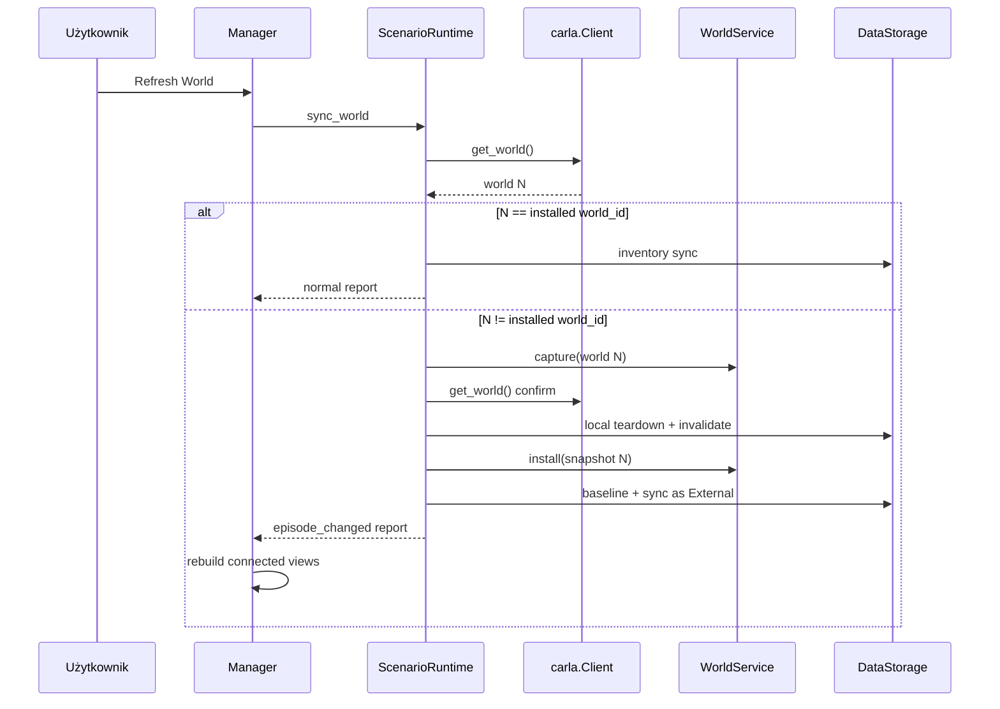
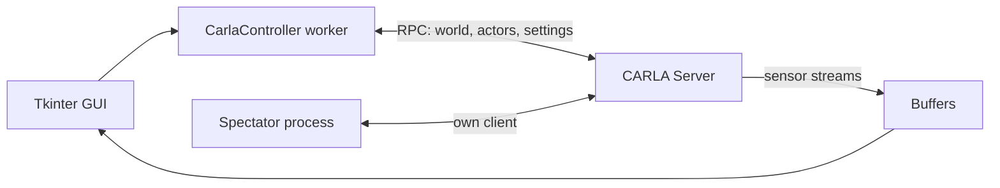
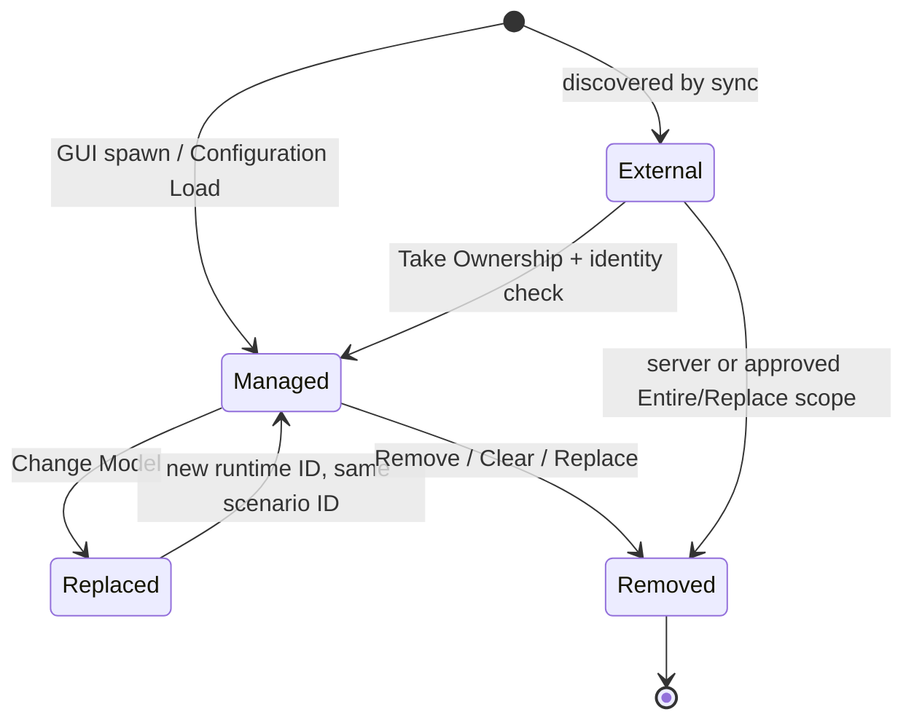
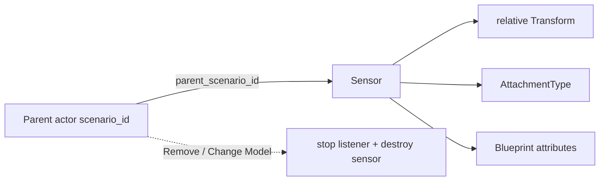
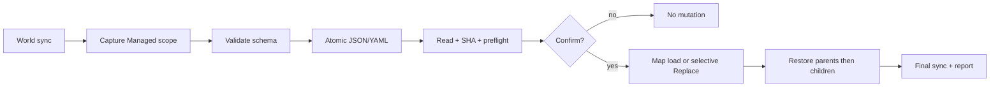

# Materiał techniczny do pracy inżynierskiej

## Jak korzystać z dokumentu

To nie jest gotowy tekst pracy. Jest to zweryfikowana mapa faktów, punktów do
interpretacji, modułów, diagramów i materiału ilustracyjnego. Przed użyciem
wyników testów należy uzupełnić dokument o faktycznie wykonane E2E.

Oznaczenia:

- **Fakt z kodu** — można wskazać moduł/klasę/funkcję;
- **Interpretacja projektowa** — uzasadnienie, które należy sformułować własnymi
  słowami i odróżnić od wymagania formalnego;
- **Do weryfikacji** — zachowanie zależne od działającego CARLA lub środowiska.

# A. Założenia i wymagania aplikacji

## Problem

CARLA Python API jest programistycznym interfejsem do zdalnego świata symulacji.
Bez dodatkowej warstwy użytkownik musi tworzyć klienta, zarządzać referencjami
`World` i `Actor`, znać blueprinty, transformy, settings, listenery, ticki oraz
lifecycle po zmianie mapy. Wieloklienckie użycie dodatkowo wymaga rozróżnienia
własnych i obcych aktorów oraz ostrożnego zarządzania Traffic Managerem.

**Fakt z kodu:** aplikacja centralizuje te operacje w `CarlaController`, services,
runtime i `DataStorage`, a GUI udostępnia formularze oraz raporty.

**Interpretacja projektowa:** GUI obniża próg obsługi i zmniejsza liczbę błędów
lifecycle, ale nie eliminuje semantyki klient–serwer ani ograniczeń CARLA.

## Cel GUI

- wykonywanie typowych operacji bez pisania skryptu dla każdej sesji;
- prezentacja bieżącego inventory i konfiguracji w spójnych widokach;
- bezpieczne oddzielenie callbacków Tkinter od blokujących RPC;
- zachowanie metadanych, których CARLA nie przechowuje, np. logical name,
  ownership i `scenario_id`;
- powtarzalne konfigurowanie środowiska symulacji w granicach dostępnego API;
- współpraca z lokalnym i zdalnym serwerem oraz wieloma klientami.

## Wymagania funkcjonalne wyprowadzone z kodu

1. Connect/Disconnect/Reconnect z hostem i portem.
2. Odczyt i zmiana świata, pogody i `WorldSettings`.
3. CRUD pojazdów, pieszych, static objects i sensorów.
4. Synchronizacja External i jawny `Take Ownership`.
5. Wiele Ego Vehicles i globalnie unikalne nazwy Managed.
6. Preview actor/sensor/movement/spectator z kontrolowanym cleanupem.
7. Sterowanie vehicle/walker: manualne, TM, BasicAgent i Walker AI.
8. Dashboard i stan ticków.
9. Configuration Save/Load JSON/YAML, preflight, Replace i Clear.
10. Wykrywanie zewnętrznej zmiany episode i odbudowa bez reconnectu.

## Wymagania niefunkcjonalne wyprowadzone z implementacji

- responsywny główny wątek Tkinter;
- serializacja operacji RPC w workerze;
- thread-safe store i bufory sensorów;
- jawne timeouty oraz raportowanie błędów etapów;
- odporność na stale world/actor references;
- izolacja procesów Pygame przez metodę `spawn`;
- walidacja przed destrukcyjnym Load/Clear;
- zgodność formatu scenariusza i ostrożne różnice API 0.9.15/0.9.16;
- brak niejawnej adopcji lub shutdown zasobów innego klienta.

## Obsługiwane środowiska i granice

**Fakt z repozytorium:** `.venv` wskazuje Python 3.12.10 z `carla 0.9.16`, a
`venvv15` Python 3.10.11 z `carla 0.9.15`. Kod jest rozwijany dla Windows.

**Fakt z kodu:** nie ma warunku „wersja==0.9.15”; zgodność opiera się na
normalizacji nazw, introspekcji API i walidacji zasobów.

**Do weryfikacji:** kompletna zgodność E2E obu par, LAN, GPU, Pygame, TM i
cross-version scenario.

Poza zakresem: uruchamianie serwera CARLA, edycja map/Unreal, trening modeli,
automatyczne testy live, gwarancja deterministyczności i koordynator rozproszony
dla ticków/TM wielu klientów.

# B. Architektura systemu

## Technologie

| Technologia | Fakt z kodu | Możliwa interpretacja |
|---|---|---|
| Python | cała aplikacja i CARLA Python API | jeden język dla GUI, RPC i testów upraszcza integrację |
| Tkinter/ttk | `../../gui`, `Manager`, `MainView` | biblioteka standardowa wystarcza do narzędzia desktopowego |
| CARLA Python API | `carla.Client`, World/Actor/Sensor/TM | oficjalny kontrakt klient–serwer zamiast własnego protokołu |
| threading/queue | worker kontrolera, event queues | izolacja blokujących RPC od event loop GUI |
| multiprocessing/Pygame | movement i spectator preview | oddzielny event loop oraz izolacja renderowania |
| JSON/YAML | scenario serializer | format czytelny dla człowieka i narzędzi |
| unittest/mock | `../../tests` | szybka regresja bez ciężkiego serwera |

## Podział odpowiedzialności

Najważniejsze punkty źródłowe:

- `app.main()` — bootstrap;
- `gui.application.Manager` — lifecycle GUI;
- `gui.main_view.MainView` — kompozycja zakładek;
- `core.controller.CarlaController._run_controller()` — client, inicjalizacja i
  główna pętla;
- `core.command_bus.CommandBus/CommandDispatcher` — routing;
- `core.state_store.DataStorage` — współdzielony stan;
- `core.contracts.RuntimeContext` — zależności usług;
- `services/*` i klasy runtime — operacje domenowe.

## Wątki, eventy i długie operacje

**Fakt z kodu:** Tkinter `mainloop()` działa w głównym wątku. `CarlaController`
ma jeden daemon thread. Publiczne metody zwykle enqueue'ują `(cmd, data)`.
Worker wykonuje synchroniczne RPC i zapisuje wyniki do store/queues. `Manager`
odpytuje je przez `after(100, ...)` lub inne interwały.

**Fakt z kodu:** callbacki sensorów zapisują do buforów z lockiem. Nie dotykają
widgetów. Pygame preview używa procesów potomnych.

**Interpretacja:** pojedynczy worker upraszcza kolejność mutacji świata i
ogranicza wyścigi libcarla. Kosztem jest head-of-line blocking: długie RPC
opóźnia inne komendy, choć GUI nadal reaguje.

**Do weryfikacji:** odczuwalna responsywność przy Town15, LAN i timeoutach.

## Stan i zdarzenia

`DataStorage` łączy dwa rodzaje danych:

- cache/proxy CARLA aktualnego episode;
- metadata GUI i prymitywne snapshots bezpieczne dla prezentacji.

To świadomy kompromis: GUI potrzebuje szybkiego odczytu, ale referencje CARLA
nie mogą przetrwać zmiany episode. Dlatego istnieją `world_id`,
`world_generation`, tokeny session i planów.

# C. Implementacja funkcjonalności

Poniższe karty są materiałem do samodzielnego opisu. Punkt „ilustracja” wskazuje
materiał, który warto przygotować.

## C1. Connection lifecycle

1. **Cel:** zestawienie sesji z lokalnym/zdalnym CARLA.
2. **Komponenty:** `ConnectionFrame`, `Manager.connect_to_carla`,
   `CarlaController.start/_run_controller`, `DataStorage`.
3. **Przebieg:** walidacja endpointu → worker → Client/get_world/resources →
   initial sync → aktywacja widoków.
4. **CARLA API:** `Client`, `set_timeout`, `get_world`, `get_available_maps`.
5. **Dane:** host/port w kontrolerze; World/cache w store.
6. **Błędy:** `connection_error`, reset widoku; brak auto-reconnect.
7. **Ograniczenia:** timeout 5 s stały; serwer/firewall poza aplikacją.
8. **Ilustracja:** Connection Frame przed i po Connect + diagram Connect.

## C2. World & Weather

1. **Cel:** wybór mapy, pogody i podglądu mapy.
2. **Komponenty:** `CustomWorldAndWeatherFrame`, `WorldService`,
   `apply_weather`, `MapPreviewGenerator`.
3. **Przebieg:** command → cleanup episode → `load_world`/fresh world → install
   → sync → GUI refresh.
4. **CARLA API:** `load_world`, `get_map`, `WeatherParameters`, `set_weather`.
5. **Dane:** map list, weather dict, spawn points, `world_id/generation`.
6. **Błędy:** etap operacji, retry/poll, recovery bieżącego świata.
7. **Ograniczenia:** world load globalny dla serwera; EmptyMap tylko ukryta w UI.
8. **Ilustracja:** combobox map/pogody i screenshot przed/po zmianie.

## C3. Actors i ownership

1. **Cel:** zarządzanie vehicle/walker/static i odróżnienie obcych aktorów.
2. **Komponenty:** trzy tab frames, `ActorService`, `WorldSynchronizer`,
   `ActorAdopter`, `ActorInfo`.
3. **Przebieg:** blueprint/transform → spawn → verify → register Managed;
   synchronizacja nieznanego → External; Take Ownership → identity check.
4. **CARLA API:** blueprint library, spawn, transform, physics, destroy.
5. **Dane:** runtime/scenario ID, logical name, origin, ownership, attributes.
6. **Błędy:** blueprint mismatch, collision, physics mismatch, stale identity.
7. **Ograniczenia:** provenance External static/infrastructure; brak rollbacku
   Change Model po zniszczeniu starego aktora.
8. **Ilustracja:** tabela z Managed/External i wieloma `[EGO]`.

## C4. Change Model

1. **Cel:** zastąpienie modelu bez zmiany logicznej tożsamości GUI.
2. **Komponenty:** actor tabs, `CarlaController` handler
   `change_actor_model`, `ActorService.replacement_attributes`.
3. **Przebieg:** validate blueprint → stop controls/previews → remove child
   sensors → destroy old → spawn new Z+0,5 m → register metadata.
4. **CARLA API:** `destroy`, `spawn_actor`, `get_physics_control`.
5. **Dane:** zachowane name/scenario_id/ownership/origin/Ego role; nowe runtime ID.
6. **Błędy:** raportuje sytuację „old removed, new failed”.
7. **Ograniczenia:** physics reset do blueprint default; sensors są usuwane.
8. **Ilustracja:** before/after model + raport warningów.

## C5. Sensors

1. **Cel:** konfiguracja attached sensors i bezpieczny podgląd.
2. **Komponenty:** `CustomSensorFrame`, `SensorService`, preview windows/buffers.
3. **Przebieg:** parent/blueprint/relative transform/attachment → spawn → listen
   → buffer → GUI snapshot → stop/destroy.
4. **CARLA API:** `spawn_actor(... attach_to, attachment_type)`, `listen`, `stop`.
5. **Dane:** parent runtime/scenario ID, relative transform, attributes,
   attachment, ownership.
6. **Błędy:** brak enumu, nieżywy parent, decoder/listener error.
7. **Ograniczenia:** attachment istniejącego sensora read-only; RSS zależny od API.
8. **Ilustracja:** Add Sensor z trzema attachment i preview image/value.

## C6. Simulation Control i Dashboard

1. **Cel:** settings, tick scheduler i obserwacja stanu.
2. **Komponenty:** `SimulationControlFrame`, `SimulationManager`,
   `SimulationRuntime`, `SimulationDashboardMonitor`.
3. **Przebieg:** refresh/propose/validate/apply settings; lokalna maszyna
   Pause/Resume/Single Step; okresowy snapshot.
4. **CARLA API:** `get_settings`, `apply_settings`, `tick`, snapshot/actors.
5. **Dane:** actual/proposed settings, control state, stats, errors.
6. **Błędy:** validation i `simulation_event_queue`.
7. **Ograniczenia:** brak rozproszonej elekcji tick mastera.
8. **Ilustracja:** settings + Dashboard w sync/async.

## C7. Movement Control

1. **Cel:** interaktywne i automatyczne sterowanie Managed actors.
2. **Komponenty:** `MovementControlSession/Window`, `MovementRuntime`,
   destination, vehicle/walker models, movement preview.
3. **Przebieg:** session token → camera/process → mode command → runtime loop →
   event state; cleanup na lifecycle.
4. **CARLA API:** `VehicleControl`, `WalkerControl`, `set_autopilot`, TM,
   `BasicAgent`, `controller.ai.walker`.
5. **Dane:** control mode, destination, route, speed, state, errors.
6. **Błędy:** stale session/world, agent/TM/controller, actor missing, stall.
7. **Ograniczenia:** Adaptive Speed heurystyczny; close window nie zatrzymuje
   automatycznie aktywnego Destination.
8. **Ilustracja:** okno z minimapą, ustawieniami prędkości i osobny Pygame.

## C8. Configuration Management

1. **Cel:** trwały opis Managed configuration i późniejsze odtworzenie.
2. **Komponenty:** cały pakiet `scenarios`, `ScenarioRuntime`, scenario frame.
3. **Przebieg:** sync/capture/validate/atomic write; read/digest/preflight/confirm/
   Replace/spawn/sync/report.
4. **CARLA API:** map/weather/settings, actors, blueprints, physics, destroy/spawn.
5. **Dane:** schema v1, metadata, world, actors, parent graph, capture report.
6. **Błędy:** parser/schema/resources/stale plan/partial restore.
7. **Ograniczenia:** Managed scope, brak atomowego snapshotu i deterministyczności.
8. **Ilustracja:** fragment JSON i raport preflight/Load.

# D. Komunikacja i synchronizacja

## Architektura poleceń

Publiczne metody kontrolera są fasadą. `CommandBus` przechowuje normal i priority
queues. Worker pobiera polecenie, sprawdza stale Movement token, uruchamia
`CommandDispatcher` lub handler runtime, aktualizuje store i emituje event.

Istotne funkcje:

- `CarlaController._get_next_command()` / `_run_controller()`;
- `CommandBus.get_next()`;
- `CommandDispatcher.dispatch()`;
- `MovementRuntime._movement_command_is_stale()`;
- pollery w `Manager` i `MovementControlSession._poll_controller_events()`.

## Synchronizacja aktorów

`WorldSynchronizer.synchronize()` porównuje bieżące `world.get_actors()` z
rejestrami. Zachowuje potwierdzone Managed record tego episode, aktualizuje
runtime properties, dodaje nieznane jako External, pomija Internal/infrastrukturę
i usuwa zniknięte. Reconnect hints mają pełną identity, nie tylko Actor ID.

**Interpretacja:** store jest materializowanym widokiem stanu serwera, a nie
autorytatywną bazą obiektów.

## Wykrywanie zmiany świata

`ScenarioRuntime._refresh_world_from_server()` porównuje świeże `world.id` z
`DataStorage.world_id`. Nazwa mapy nie wystarcza, ponieważ reload tej samej mapy
tworzy nowy episode. Dla nowego ID wykonuje stabilizowany snapshot, teardown,
invalidate, install i full sync.

## Synchronizacja wielu klientów

Mechanizmy ochronne:

- unknown actors → External;
- identity check przed adoption;
- Managed-only Save;
- shared TM bez shutdown/sync reconfiguration;
- dedicated Exclusive ports dla wielu GUI;
- External World Refresh po `load_world()` drugiego klienta;
- stale plan/session guards.

Brak mechanizmów:

- globalny lock map changes;
- elekcja tick mastera;
- blokada dwóch klientów sterujących tym samym actorem;
- transakcja rozproszona dla Scenario Replace.

Te braki są ważnym materiałem do ograniczeń i dalszego rozwoju.

## Asynchroniczność

Należy rozróżnić:

- asynchronous/synchronous mode świata CARLA (`WorldSettings`);
- asynchroniczną względem GUI realizację RPC w Python worker thread;
- asynchroniczne callbacki sensorów;
- osobne procesy preview;
- kolejki eventów GUI.

Są to niezależne osie. „Asynchronous CARLA” nie oznacza, że kod RPC używa
`asyncio`; implementacja używa zwykłych wątków i kolejek.

# E. Zarządzanie konfiguracją symulacji

## Model danych i serializacja

Podstawa: `models.scenarios` (`ScenarioMetadata`, `ScenarioWorld`,
`ScenarioActor`, `ActorCompleteness`, `CaptureReport`, `ScenarioDocument`).
Serializer używa schema v1 i atomowego replace. Validator zabrania nie-finite
numbers, duplikatów i błędnego grafu parentów.

## Deserializacja i preflight

`ScenarioSerializer.read_snapshot()` zwraca dokument i SHA-256.
`ScenarioLoader.prepare()` sprawdza mapę, wersję, blueprinty, attributes,
physics, attachment i completeness oraz buduje topological order. Plan wiąże się
z plikiem i episode.

## Restore i ownership

`ScenarioRestorer.execute()` weryfikuje plan, wykonuje map load lub selective
clear, odtwarza parentów przed sensorami/controllers, stosuje konfigurację i
rejestruje wyłącznie utworzone obiekty jako Managed/Scenario Loaded. Końcowy
WorldSynchronizer nie przejmuje innych aktorów.

## Powtarzalność

Należy opisać jako **odtwarzalność konfiguracji**, nie pełną deterministyczność.
CARLA runtime IDs, timing, traffic, collision resolution, sensor frames i trasy
mogą się różnić. Capture przy wielu klientach nie jest atomowe, a Replace nie ma
pełnego rollbacku.

# F. Testowanie i weryfikacja

## Cele

- kontrakty danych i walidacja;
- poprawna kolejność lifecycle;
- brak stale references;
- zachowanie ownership i granic klienta;
- poprawny cleanup;
- kompatybilność zasobów v15/v16;
- użyteczność i responsywność GUI w E2E.

## Rodzaje

1. Jednostkowe: helpers, converters, validator, settings, state models.
2. Komponentowe z fake CARLA: controller/services/runtime, scenario round trip.
3. Regresyjne: map compatibility, TM lifecycle, Change Model, external refresh.
4. Manualne E2E: rzeczywisty server/API, GUI, GPU, LAN i multi-client.

## Stan dowodów

**Fakt:** katalog zawiera statycznie 42 moduły i 533 metody testowe.

**Fakt:** historyczne raporty opisują wykonane celowane przebiegi dla wcześniejszych
zmian.

**Fakt:** manualna checklista jest niezaznaczona.

**Wniosek metodologiczny:** w pracy oddzielić „test istnieje”, „test uruchomiono
na mockach dla danego commita” i „E2E zaliczono na konkretnej wersji serwera”.

## Środowiska i kryteria

Minimalna macierz: v15/Python 3.10.11 i v16/Python 3.12.10; localhost/LAN;
single/multi-client; sync/async. Kryteria: zgodność danych, brak crash/hang,
brak stale proxy, właściwy ownership, cleanup i czytelny raport błędu.

## Ograniczenia

Mocki nie dowodzą zachowania libcarla/Unreal. Brak coverage metric. Brak
automatycznych live tests. Arkusz Excel nie znajduje się w repozytorium.

# G. Diagramy i ilustracje

## Diagramy Mermaid gotowe do adaptacji

### Architektura klient–serwer

### Lifecycle aktora i sensora

### Configuration Save/Load

Diagramy Connect i Refresh znajdują się w sekcjach B/D. Model Movement/Traffic
Manager znajduje się w [MOVEMENT_CONTROL.md](MOVEMENT_CONTROL.md).

## Proponowane zrzuty ekranu

1. Connection Manager przed Connect i Main View po Connect.
2. World & Weather z listą map bez EmptyMap i dynamicznymi presetami.
3. Vehicles z dwoma Ego, Managed i External.
4. Change Model: okno wyboru i tabela po zmianie; osobno komunikat o sensorach.
5. Add Sensor z Attachment Type oraz Sensor Preview.
6. Simulation Control w synchronous mode i Dashboard.
7. Movement Control vehicle z Destination, Maximum/Adaptive Speed i minimapą.
8. Movement Control walker w trybie Random/Destination.
9. Spectator Preview z overlayem.
10. Configuration Save dialog, preflight report i final Load report.
11. External World Refresh: stan przed zmianą przez klienta 2 i odbudowany GUI.
12. Controlled error: stale preflight lub zajęty Exclusive TM port.

Każdy screenshot powinien mieć podpis z wersją serwera, mapą, trybem sync/async
i informacją, czy dane pochodzą z E2E czy demonstracji.

# H. Powiązanie z rozdziałami pracy

| Planowana część | Materiał | Moduły kodu | Diagramy/ilustracje |
|---|---|---|---|
| Charakterystyka CARLA | klient–serwer, World/Actor/Sensor, episode, sync/async, TM | `../../services/world.py`, `scenarios/synchronization.py`, `simulation/manager.py` | klient–serwer, actor lifecycle |
| Komunikacja i technologie | Python API, worker, queues, callbacks, processes, timeouts | `../../core/controller.py`, `command_bus.py`, `contracts.py`, `preview/*` | command flow, Connect, Refresh |
| Projekt i implementacja GUI | Tkinter composition, DataStorage, tabs, services, ownership | `gui/*`, `../../core/state_store.py`, `models/actors.py`, `services/*` | architektura aplikacji, screenshots 1–9 |
| Configuration Management | schema, capture, preflight, Replace, restore, limits | `../../models/scenarios.py`, `scenarios/*` | Save/Load, parent–sensor |
| Movement Control | manual, BasicAgent, walker, TM ownership | `movement/*`, `../../gui/windows/movement_control.py` | Movement/TM model, screenshot 7–8 |
| Testowanie i weryfikacja | unittest/mock, regresje, E2E matrix, kryteria | `tests/*`, `../TESTING.md` | macierz środowisk, evidence screenshots |
| Wnioski i rozwój | ograniczenia worker, live tests, distributed coordination, rollback | dokumenty kanoniczne i wyniki przyszłych E2E | diagram luk i proponowane usprawnienia |

## Dokumenty pomocnicze

- [Architektura](ARCHITECTURE.md)
- [Komunikacja](CARLA_COMMUNICATION.md)
- [GUI](GUI_FUNCTIONALITIES.md)
- [Configuration Management](SCENARIO_MANAGEMENT.md)
- [Movement](MOVEMENT_CONTROL.md)
- [Testowanie](TESTING.md)

## Tematy do wniosków i dalszego rozwoju

Poniższe są propozycjami analitycznymi, nie zaimplementowanymi funkcjami:

- automatyczne live integration tests uruchamiane osobno dla v15/v16;
- konfiguracja timeoutu i endpointów poza GUI session;
- jawny protokół tick-master/multi-client coordination;
- trwalsza identyfikacja aktorów między reconnectami;
- rozdzielenie dużych runtime/controller modules;
- postęp i anulowanie długich RPC;
- wersjonowana migracja schema po przekroczeniu v1;
- lepszy rollback/compensation dla częściowego Scenario Replace;
- telemetryka i eksport raportu E2E bez mieszania z dokumentacją planu testów.
