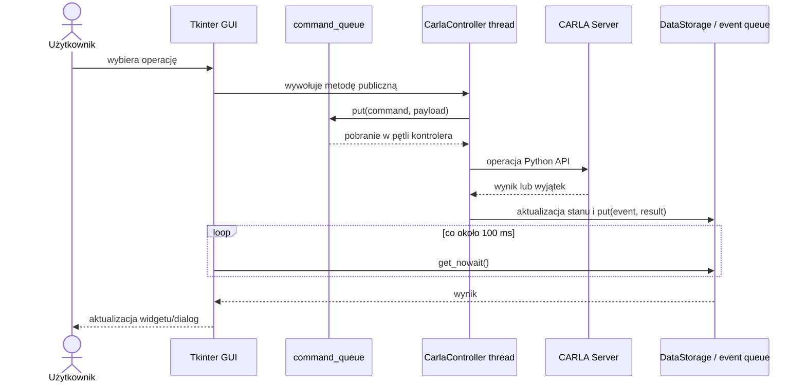

# Komunikacja z serwerem CARLA

## Nawiązywanie połączenia

Użytkownik podaje host i port w `ConnectionFrame`. Wartości domyślne to `127.0.0.1` i `2000`; GUI sprawdza niepusty host oraz port z zakresu 1–65535. `gui.application.Manager.connect_to_carla()` tworzy `CarlaController(database, spectator_status_callback, host, port)`, uruchamia jego wątek metodą `start()` i rozpoczyna polling `connection_queue` przez `after(100, check_connection)`. Kontroler nie przechowuje całego `Manager`; callback zwraca wyłącznie stan i ID kamery Spectatora potrzebne dashboardowi.

`core.controller.CarlaController._run_controller()` wykonuje w wątku roboczym:

1. `carla.Client(host, port)`;
2. `client.set_timeout(5.0)`;
3. `client.get_world()`;
4. pobranie ustawień, blueprintów, pogody, map i spawn pointów;
5. zapis referencji i danych do `DataStorage`;
6. początkową synchronizację przez `WorldSynchronizer`;
7. publikację `("connected", sync_report)`.

Błąd dowolnego z tych kroków publikuje `("connection_error", message)`. Timeout połączenia nie jest konfigurowalny w GUI.

## Referencje klienta i świata

- `CarlaController.client` jest właścicielem głównego `carla.Client`.
- Lokalna zmienna `world` w `_run_controller()` jest referencją używaną przez pętlę wykonawczą.
- `DataStorage.world` udostępnia bieżący świat pozostałym komponentom. Kanoniczna implementacja store'a znajduje się w `core/state_store.py`; stara ścieżka jest shimem.
- `DataStorage.blueprint_lib`, `world_lib`, `available_spawn_points`, dane pogody i ustawienia symulacji są cache'em bieżącego epizodu.

Po zmianie świata kontroler zastępuje referencje, czyści nieaktualne rejestry runtime i ponownie pobiera dane. Po rozłączeniu `Manager` tworzy całkowicie nowy `DataStorage`.

Referencja `CarlaController.traffic_manager` jest lokalnym proxy do TM na porcie
`8000`, a nie prywatnym magazynem stanu aplikacji. Przed zmianą epizodu
aplikacja czyści ścieżki i wyłącza autopilot wyłącznie dla pojazdów MANAGED.
Przed `load_world()` odrzuca stare proxy. Nie wywołuje API TM bezpośrednio po
zmianie epizodu; proxy jest pobierane leniwie przy pierwszej aktywacji
autopilota w nowym świecie, a wtedy tryb synchroniczny jest uzgadniany z jego
ustawieniami. Nie wykonuje globalnego resetu TM, ponieważ port może być
współdzielony z innymi klientami.

W CARLA 0.9.16 samo odrzucenie Pythonowego proxy nie usuwa instancji TM.
Biblioteka `libcarla` przechowuje procesową statyczną mapę instancji według
portu. Dlatego nowy `CarlaController`, nowy `carla.Client` oraz reconnect w tym
samym procesie mogą ponownie trafić na wpis portu `8000` utworzony dla
poprzedniego epizodu. Dopiero zakończenie procesu albo `TrafficManager.shut_down()`
usuwa ten wpis. Aplikacja nie wywołuje `shut_down()` automatycznie, ponieważ
Python API nie ujawnia, czy bieżący proces jest właścicielem lokalnego serwera
TM; dla zdalnego proxy ta operacja zatrzymałaby współdzielony serwer TM.

Ograniczoną diagnostykę lifecycle włącza zmienna
`CARLA_MANAGER_TM_DEBUG=1`. Log powstaje wyłącznie w workerze podczas Connect,
Disconnect, Load World, inicjalizacji TM i Free Roam. Zawiera identyfikatory
procesu, kontrolera, klienta i Pythonowego proxy TM, port, token epizodu,
ustawienia synchronizacji oraz informację, czy port był już użyty przez ten
proces. Pole własności ma celowo wartość `unknown_not_exposed_by_carla_api`.
Punkty `tm_proxy_acquired` i `tm_sync_applied` rozdzielają pobranie proxy od
konfiguracji, natomiast `world_cleanup_*` oraz `load_world_rpc_*` obejmują
granicę zmiany epizodu. Przy natywnym assertion ostatni zapisany punkt pozwala
odróżnić cleanup aktora lub Movement Preview od awarii wewnątrz `load_world()`
albo ponownej inicjalizacji TM.

### Tryb shared i exclusive Traffic Managera

Domyślnie aplikacja używa portu `8000` w trybie shared. Port można zmienić
przez `CARLA_MANAGER_TM_PORT`, ale dopóki
`CARLA_MANAGER_TM_EXCLUSIVE` nie ma wartości `1`, `true`, `yes` lub `on`,
aplikacja nigdy nie wywołuje `TrafficManager.shut_down()`.

Tryb exclusive wymaga jawnie ustawionego portu innego niż `8000`. Przed
utworzeniem TM aplikacja sprawdza, czy port loopback jest wolny i czy inny
`CarlaController` w tym samym procesie nie posiada już kontraktu dla tego
portu. Zajęty port przerywa inicjalizację; aplikacja nie dołącza do nieznanego
TM i nie próbuje go zatrzymać. Po utworzeniu proxy zapisywany jest lokalny
kontrakt własności. Tylko takie proxy może zostać zatrzymane przed zmianą mapy
lub Disconnect.

Sprawdzenie portu nie jest technicznym dowodem własności: pomiędzy testem a
`get_trafficmanager()` pozostaje okno race condition, a CARLA 0.9.16 nie
ujawnia w Python API, czy zwrócono lokalny TM-Server, czy TM-Client. Port musi
więc być administracyjnie zarezerwowany dla pojedynczego procesu aplikacji.
Flaga exclusive jest potwierdzeniem tego kontraktu, a nie mechanizmem
rezerwacji portu wobec obcych klientów.

W trybie exclusive kolejność przejścia epizodu to: blokada komend Movement,
wyłączenie autopilota MANAGED actors, cleanup Movement/Walker/Preview,
`TrafficManager.shut_down()`, odrzucenie proxy, `load_world()` i leniwa
inicjalizacja nowego TM. Błąd własności lub shutdown przerywa zmianę świata
przed `load_world()`.

## Polecenia GUI

Publiczne metody `CarlaController`, np. `spawn_actor()`, `change_world()`, `attach_sensor()` czy `apply_simulation_settings()`, walidują podstawowe warunki i umieszczają `(command_name, payload)` w `command_queue`.

`core.command_bus.CommandBus` opakowuje istniejące kolejki bez zmiany ich publicznej dostępności. Najpierw pobierana jest kolejka priorytetowa, a wewnątrz każdej kolejki zachowane jest FIFO. `CommandDispatcher` obsługuje zarejestrowane komendy World/Actors/Sensors i wywołuje handler bezpośrednio w tej samej iteracji workera. Komendy Movement, Simulation i Scenario są routowane przez koordynator do odziedziczonych implementacji z `movement.runtime`, `simulation.runtime` i `scenarios.runtime`.

Delegowany przepływ ma postać: `GUI → publiczne API CarlaController → CommandBus → CommandDispatcher → usługa → CARLA`. Wyjątki nie są ukrywane przez dispatcher; trafiają do istniejącego centralnego error boundary lub do zachowanej obsługi błędów konkretnej operacji.

`priority_command_queue` służy obecnie do szybkiego zatrzymania/pauzy lokalnego sterowania tickami. `_get_next_command()` zawsze sprawdza ją przed zwykłą kolejką. Polecenia ruchu otrzymują dodatkowo identyfikator świata, dzięki czemu `_movement_command_is_stale()` może odrzucić komunikat po zmianie epizodu.

Pętla kontrolera nie jest wyłącznie konsumentem kolejki. Między poleceniami wykonuje także:

- `SimulationRuntime._service_simulation()` — lokalne ticki lub obserwację ramek;
- metody `MovementRuntime` — sterowanie manualne, nawigację pojazdu i pieszych;
- `SimulationRuntime._service_dashboard()` — okresową aktualizację monitoringu;
- `ScenarioRuntime` — kontrolę planów i synchronizację scenariusza; kontroler nadal koordynuje pozostałe zasoby podglądu.

## Wyniki i aktualizacja GUI

Kontroler publikuje wyniki do kolejek w `DataStorage`:

| Kolejka | Przykładowe zdarzenia | Konsument |
|---|---|---|
| `connection_queue` w kontrolerze | `connected`, `connection_error`, `disconnected` | `Manager.check_connection()` |
| `actor_event_queue` | wyniki spawnu, zmiany modelu i fizyki | widoki aktorów |
| `sensor_event_queue` | start/błąd podglądu i operacje sensora | `CustomSensorFrame` |
| `movement_event_queue` | stan podglądu, kontroli, AI i celu | `movement.session.MovementControlSessionManager` |
| `simulation_event_queue` | ustawienia i stan kontrolera ticków | `Manager.check_simulation_events()` |
| `scenario_event_queue` | synchronizacja, save/load/clear, adoption | `Manager._check_scenario_events()` |

Callbacki danych sensorów zapisują wyniki do klas z `preview.sensor_buffers`, które używają blokad i nie importują Tkinter. Okna z `gui.windows.sensor_preview` pobierają migawki przez cykliczne `after()` i anulują zadania podczas zamykania; callback CARLA nie modyfikuje widgetów.
| `map_preview_event_queue` | `map_preview_ready`, `map_preview_failed` | `CustomWorldAndWeatherFrame` |

GUI odpytuje je metodami `get_nowait()` wywoływanymi z callbacków `after`. Dzięki temu widgety są aktualizowane w głównym wątku Tkinter.

## Przykładowy przepływ polecenia

## Wątki i procesy

### Wątek kontrolera

`CarlaController.start()` uruchamia pojedynczy `threading.Thread(..., daemon=True)`. To główna granica wykonywania operacji CARLA. `shutdown_event`, `world_changed_event` i `world_transition_event` sygnalizują zatrzymanie oraz zmianę świata.

`WorldService`, `ActorService`, `SensorService`, `BlueprintService`, funkcja pogodowa oraz trzy klasy runtime nie uruchamiają dodatkowych wątków. Runtime nie pobierają samodzielnie komend i nie mają własnych pętli. Callback `sensor.listen()` nadal może wejść z wątku CARLA, ale zapisuje wyłącznie do istniejącego thread-safe bufora i nie aktualizuje Tkinter.

### Callbacki sensorów

CARLA wywołuje callbacki sensorów poza głównym wątkiem Tkinter. Callbacki konwertują lub kopiują dane do buforów chronionych `threading.Lock`. Klasy `*PreviewTop` pobierają migawki przez `after`, więc tworzenie `PhotoImage`, konfiguracja widgetów i odświeżanie Matplotlib odbywają się w wątku GUI.

`GhostPreview.on_camera_image()` stosuje ten sam model: zapisuje `PIL.Image` pod blokadą, a `ActorPreviewFrame` tworzy `ImageTk.PhotoImage` dopiero podczas pollingu Tkinter.

### Movement Preview

`MovementPreviewProcess` używa kontekstu `multiprocessing` z metodą `spawn`. Proces Pygame otrzymuje ramki przez kolejkę o rozmiarze 1 i odsyła wejście sterujące przez drugą kolejkę. Sensor i zastosowanie komend pozostają w `CarlaController`; proces potomny nie tworzy klienta CARLA.

### Spectator Preview

`preview.spectator.SpectatorPreviewManager` również używa procesu `spawn`, ale top-level `preview.spectator.run_spectator_preview()` tworzy własny `carla.Client`, kamerę RGB oraz bezpośrednio ustawia transformację `spectator` i kamery. Proces sprawdza zmianę `world.id` i kończy się po wykryciu nowego epizodu. To zamierzony wyjątek od głównej kolejki kontrolera, ale oznacza równoległego klienta modyfikującego świat. Pygame jest importowany dopiero wewnątrz targetu procesu.

## Synchronizacja ze światem

`WorldSynchronizer.synchronize()` odczytuje `world.get_actors()`, klasyfikuje aktorów i uzgadnia ich z `actors_db` oraz `sensors_db`. Rekordy utworzone przez GUI pozostają `managed`; wykryte wyłącznie na serwerze są zapisywane jako `external`. Nieobecne rekordy runtime są usuwane. Przed pierwszą synchronizacją Connect/Reconnect kontroler zapisuje baseline statycznej infrastruktury bieżącego `world.id`; taki sam baseline jest odbudowywany po kontrolowanej zmianie mapy. Synchronizacja jest wykonywana m.in. po połączeniu, na żądanie Refresh World, przed zapisem scenariusza i po operacjach destrukcyjnych.

`SimulationDashboardMonitor` tworzy niezależne migawki monitoringu na podstawie świata i lokalnych rejestrów. Nie zastępuje synchronizatora ani rejestrów aktorów.

## Zmiana mapy

`Manager.begin_world_change()` blokuje odpowiednie widoki, zatrzymuje Movement Control, lokalne ticki i Spectator Preview. `CarlaController.change_world()` ustawia flagi przejścia i kolejkuje polecenie.

Wątek kontrolera:

1. zatrzymuje sterowanie pojazdami, pieszymi i podgląd ruchu;
   autopilot jest wyrejestrowywany bez kolejkowania nowej operacji `set_path()`
   tuż przed zmianą epizodu;
2. tymczasowo ustawia timeout klienta na 30 sekund;
3. wywołuje `client.load_world(map_name)`;
4. jeśli `load_world()` zgłosi `RuntimeError`, maksymalnie dziesięć razy sprawdza aktualny świat w odstępach 1 s;
5. odbudowuje cache świata i rejestry;
6. synchronizuje aktorów oraz kolejkuje generowanie podglądu mapy;
7. pozostawia Traffic Managera niezainicjalizowanego aż do pierwszej aktywacji
   autopilota w nowym świecie;
8. publikuje wynik przez stan i kolejki.

Zmiana mapy unieważnia procesy/podglądy zależne od epizodu oraz plany Load/Clear utworzone dla poprzedniego `world.id`.

## Rozłączenie i ponowne połączenie

`Manager.disconnect_from_carla()` wyłącza zakładki, zamyka podglądy, zatrzymuje sterowanie symulacją i wywołuje `CarlaController.shutdown()`. Kontroler ustawia `shutdown_event`, anuluje aktywne plany i wkłada polecenie `shutdown`, jeżeli wątek nadal żyje.

Po odebraniu `disconnected` lub błędu `Manager.finish_disconnection()`:

- niszczy widoki zależne od połączenia;
- zeruje flagi workflow;
- odłącza menedżera ruchu i podglądy;
- usuwa referencję do kontrolera;
- tworzy nowy `DataStorage` i nowy lokalny `Actors` dla `MainView`.

Ponowne połączenie tworzy nowy `CarlaController`. Nie ma mechanizmu automatycznego reconnect ani zachowania lokalnego cache runtime między sesjami.

## Obsługa błędów komunikacji

- Błąd inicjalizacji lub nieobsłużony wyjątek w `run()` kończy kontroler, czyści podsystemy i publikuje `connection_error`.
- Operacje domenowe zwykle przechwytują wyjątek i publikują zdarzenie `*_error` lub raport częściowego powodzenia.
- Dashboard przechowuje ostatni błąd w `application_status`.
- Procesy podglądu wysyłają `error` i `closed` przez kolejkę IPC; menedżery mogą je zakończyć przez `terminate()` i `kill()` po timeoutach.
- Kod stosuje liczne szerokie `except Exception`; gwarantuje to raportowanie, ale utrudnia odróżnienie błędu połączenia od błędu danych lub programu.

## Bezpieczeństwo Tkinter

Główny mechanizm jest poprawny: worker i callbacki nie aktualizują widgetów, lecz przekazują dane przez kolejki/bufory. Istnieją jednak miejsca wymagające ostrożności:

- `DataStorage` udostępnia żywe obiekty CARLA, a GUI czasem odczytuje je bez kolejki, np. `GhostPreview.get_transform()`; może to wykonać RPC poza wątkiem kontrolera.
- Nie wszystkie odczyty i zapisy `DataStorage` są objęte `database.lock`.
- `CarlaController` przechowuje referencję do `Manager` i odczytuje z niej status Spectator Preview, co sprzęga worker z obiektem GUI, choć nie modyfikuje wtedy widgetów.
- Proces Spectator komunikuje się z CARLA niezależnie od kontrolera, więc serializacja operacji oparta na `command_queue` go nie obejmuje.

Przed refaktoryzacją warto formalnie rozdzielić: komunikaty GUI, komendy CARLA, zdarzenia wynikowe oraz immutable snapshots widoków.
