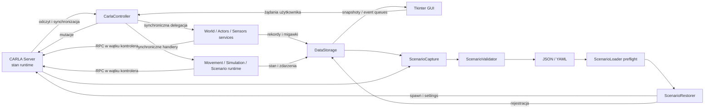
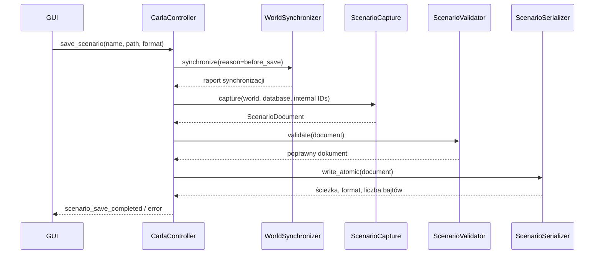

# Przepływ i przechowywanie danych

## Model ogólny

CARLA Server przechowuje bieżący stan świata i aktorów. Aplikacja buduje lokalną projekcję tego stanu w `DataStorage`, wzbogaconą o informacje, których serwer nie dostarcza wprost: nazwy użytkownika, ownership, trwałe `scenario_id`, kompletność konfiguracji oraz stan sterowania GUI.

## Źródła prawdy

| Rodzaj danych | Źródło prawdy | Lokalna reprezentacja | Uwagi |
|---|---|---|---|
| Połączenie | `Manager.carla` i stan wątku kontrolera | `Manager.connected`, `disconnecting`, `closing` | `connection_queue` przenosi zmianę stanu do GUI. |
| Bieżący świat i mapa | `carla.Client.get_world()` / `carla.World` | `DataStorage.world`, `world_lib`, `available_spawn_points` | Referencje są ważne tylko dla bieżącego `world.id`. |
| Pogoda i `WorldSettings` | CARLA World | `actual_weather_data`, `actual_simulation_settings` | Proposed settings są wyłącznie danymi formularza. |
| Aktorzy runtime | `world.get_actors()` | `actors_db`, `sensors_db` | Rejestry są synchronizowaną projekcją, nie pełną kopią atomową. |
| Metadane GUI | `ActorInfo` / `SensorInfo` | nazwa, ownership, origin, `scenario_id`, completeness | CARLA nie zna tych wartości. |
| Stan ruchu zarządzanego | kontroler i rzeczywisty aktor CARLA | `vehicle_control_states`, `walker_ai_states` | Dla aktora external stan może być oznaczony jako nieznany. |
| Stan kontroli symulacji | `SimulationManager` oraz CARLA settings/frame | `simulation_control_state` | Migawka jest publikowana do GUI. |
| Dashboard | wyliczenia `SimulationDashboardMonitor` | cztery słowniki snapshotów w `DataStorage` | Dane pochodne, nie źródło do mutacji świata. |
| Scenariusz na dysku | plik JSON/YAML | `ScenarioDocument`/słowniki | Przy Load plik opisuje stan docelowy, ale podlega preflight i ponownej walidacji. |
| Podgląd mapy | geometria `carla.Map` | PNG w `resources/maps/generated/` | Cache jest pochodny; stary `images/maps/generated/` pozostaje źródłem odczytu zgodności. |

## `DataStorage`

Implementacja znajduje się w `core/state_store.py`. Modele rekordów znajdują się w `models/actors.py`, a kolekcje runtime w `core/registries.py`.

### Rejestry aktorów

`DataStorage.actors_db` jest rejestrem `Actors`, a `DataStorage.sensors_db` rejestrem `Sensors`. Ich słowniki `actors_db` i `sensors_db` przechowują odpowiednio `ActorInfo` i `SensorInfo`, indeksowane runtime ID CARLA. Rekord zawiera żywą referencję do aktora oraz metadane scenariusza. `WorldSynchronizer` aktualizuje rekordy i usuwa te, których nie ma już w bieżącym świecie.

`ActorOwnership.MANAGED` oznacza aktora, którym aplikacja może mutować. `EXTERNAL` oznacza aktora wykrytego na serwerze, ale nieutworzonego ani nieprzejętego przez GUI. `ActorAdopter` może po sprawdzeniu tożsamości zmienić istniejący rekord external na managed bez niszczenia aktora.

### Sensory

`SensorInfo` przechowuje parent runtime ID, blueprint, transformację względną, atrybuty i typ attachment. Dane pomiarowe nie są utrwalane w `DataStorage`; trafiają do właściwego bufora podglądu. Kontroler przechowuje zbiór aktywnie streamujących sensorów i błędy ich statusu na potrzeby dashboardu.

### Stan ruchu

`vehicle_control_states` i `walker_ai_states` są słownikami indeksowanymi runtime ID. Zawierają tryb, status, błędy, identyfikator świata i dane celu. Dla nowego managed vehicle/pedestrian stan powstaje w `DataStorage.add_actor()`. Zmiana świata lub usunięcie aktora usuwa powiązany stan.

### Stan symulacji i dashboardu

`simulation_control_state` jest migawką `SimulationManager`. `simulation_snapshot`, `actor_statistics`, `sensor_statistics` i `application_status` są zastępowane przez `SimulationDashboardMonitor`; widok dashboardu tylko je odczytuje i renderuje.

## Aktorzy zarządzani i zewnętrzni

`ActorClassifier` rozpoznaje pojazdy, pieszych, obiekty statyczne, sensory, kontrolery AI pieszych, infrastrukturę świata i aktorów wewnętrznych podglądu. Lista internal actor IDs powstaje w kontrolerze z ghosta, kamer podglądu i innych zasobów technicznych.

Synchronizacja rozdziela:

- managed — lokalny rekord zachowuje ownership i metadane GUI;
- external — rekord tworzony z danych możliwych do odczytu z serwera;
- world infrastructure — element mapy nieuwzględniany jak zwykły aktor scenariusza;
- internal preview — tymczasowy zasób aplikacji.

Stan świata może zmienić się przez innego klienta w trakcie odczytu. `ScenarioCapture` jawnie raportuje, że CARLA nie dostarcza atomowego snapshotu całego świata przy aktywnych klientach zewnętrznych.

## Dane sensorów

Przepływ przykładowej kamery:

1. kontroler tworzy sensor i wywołuje `sensor.listen(callback)`;
2. callback CARLA przekazuje `carla.Image` do `SensorPreviewBuffer`;
3. bufor konwertuje/kopiuje dane i aktualizuje revision pod blokadą;
4. `SensorPreviewTop` co określony czas pobiera snapshot;
5. GUI tworzy obiekt obrazu i aktualizuje widget.

Pozostałe bufory obsługują wartości, zdarzenia (np. collision) oraz chmury punktów LiDAR/radar. Dane są ulotne i nie trafiają do pliku scenariusza.

## Dane scenariusza

Implementacja przepływu jest rozdzielona między `scenarios.runtime` (orkiestracja w workerze) oraz `scenarios.capture`, `scenarios.validation`, `scenarios.serialization`, `scenarios.loader`, `scenarios.restorer`, `scenarios.cleaner`, `scenarios.synchronization` i `scenarios.adoption`. Typy dokumentu znajdują się w `models.scenarios`.

`ScenarioDocument` zawiera:

- metadane (`name`, wersja i czas utworzenia zgodnie z modelem);
- świat: krótka nazwa mapy, ID świata z chwili zapisu, pogoda i ustawienia symulacji;
- listę `ScenarioActor`;
- raport capture.

Każdy aktor scenariusza może zawierać trwałe `scenario_id`, kategorię, nazwę, blueprint, transformację, atrybuty blueprintu, źródła danych, completeness, parent `scenario_id`, attachment, fizykę pojazdu i dane sterowania — zależnie od kategorii i dostępności informacji.

JSON jest obsługiwany przez `json`, YAML przez `yaml.safe_dump`/`safe_load`. `ScenarioSerializer.write_atomic()` zapisuje UTF-8 do pliku tymczasowego, wykonuje `fsync`, a następnie `os.replace()`.

## Zapis scenariusza

### Zakres zapisu

Aktualny kod zapisuje kategorie: vehicle, pedestrian, static object, sensor i restorable walker AI controller. Kandydat musi mieć rekord lokalny i być `managed`; aktorzy external są pomijani. Pomijane są również:

- aktorzy internal preview i infrastruktura mapy;
- kategorie niewspierane;
- rekordy runtime-only lub unrestorable;
- zależności osierocone, np. sensor bez zapisywanego rodzica;
- kontroler pieszego bez kompletnego aktywnego celu i prędkości.

Rekord partial może zostać zapisany, a ograniczenia trafiają do `CaptureReport`. To istotna różnica względem dawnych założeń mówiących o zapisie wszystkich zewnętrznych aktorów.

## Odczyt scenariusza

Load jest dwuetapowy.

### Preflight

`ScenarioLoader.prepare()`:

1. odczytuje plik oraz SHA-256;
2. waliduje dokument;
3. porównuje mapę bieżącą i docelową;
4. sprawdza dostępność mapy, blueprintów, atrybutów, fizyki i zależności;
5. ogranicza wejście do wspieranego zakresu managed Scenario Load;
6. buduje kolejność topologiczną rodzic–dziecko;
7. tworzy `ScenarioLoadPlan` z tokenem, `world_id`, statusem, ostrzeżeniami i problemami krytycznymi.

Preflight nie mutuje świata. GUI przedstawia plan użytkownikowi i dopiero potwierdzenie kolejkuje wykonanie.

### Wykonanie

`ScenarioRestorer.execute()` ponownie odczytuje plik, porównuje hash, sprawdza `world_id` i ponawia preflight. Następnie:

- przy innej mapie ładuje świat i wykonuje walidację po zmianie;
- przy tej samej mapie planuje selective clear w trybie `SCENARIO_REPLACE`, sprawdza cascade dependencies i usuwa zatwierdzony zakres;
- stosuje pogodę i ustawienia symulacji;
- odtwarza aktorów w kolejności zależności;
- rejestruje aktorów jako `MANAGED` z origin `SCENARIO_LOADED`;
- stosuje fizykę pojazdów i odtwarzalny stan sterowania;
- synchronizuje końcowy świat oraz publikuje raport success/partial/failed.

Pojazd otrzymuje podczas spawnu offset Z równy 0,2 m. Sensory są tworzone z rodzicem i transformacją względną. Błąd pojedynczego aktora jest zapisywany w raporcie; zależne dzieci są pomijane, dlatego wynik może być częściowy.

## Synchronizacja lokalna a stan serwera

Nie istnieje transakcja obejmująca jednocześnie CARLA i `DataStorage`. Kod ogranicza ryzyko przez:

- serializację mutacji w wątku kontrolera;
- blokadę scenariusza i tokeny planów;
- identyfikator `world.id` w poleceniach oraz planach;
- ponowną walidację przed destrukcyjnym Load/Clear;
- synchronizację po operacji;
- raporty partial success zamiast ukrywania rozbieżności.

Mimo tego zewnętrzny klient CARLA może zmienić świat pomiędzy odczytami. Dokumentacja i przyszłe testy powinny traktować synchronizację jako uzgadnianie stanu, nie jako atomową replikację.
