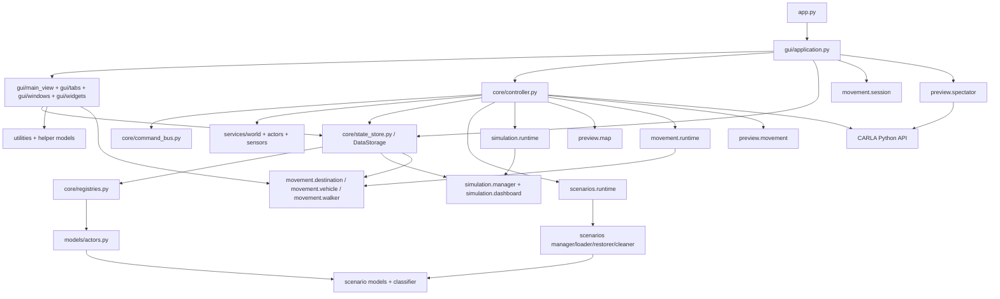

# Moduły i zależności

## Zakres

Tabela opisuje moduły zawierające logikę produkcyjną po zakończeniu etapu 4B.10. Pliki z `tests/` nie są częścią tej mapy. Nazwy klas i funkcji pochodzą z aktualnego kodu; usunięte ścieżki legacy pozostają opisane historycznie w [REFACTOR_PLAN.md](legacy/REFACTOR_PLAN.md).

## Moduły główne i usługi

| Moduł | Najważniejsze elementy | Odpowiedzialność i zależności |
|---|---|---|
| `app.py` | `main` | Kanoniczny entrypoint: `freeze_support()`, utworzenie `Manager` i `mainloop()`; import nie inicjalizuje GUI. |
| `gui/application.py` | `Manager` | Composition root, polling zdarzeń i lifecycle GUI. Przekazuje kontrolerowi wyłącznie callback statusu Spectatora, nie cały obiekt aplikacji. |
| `gui/main_view.py` | `MainView` | Główny Notebook, dynamiczne tworzenie/niszczenie zakładek i koordynacja aktywnego ghost preview. |
| `core/controller.py` | `CarlaController` | Fasada, właściciel pojedynczego workera, centralny error boundary i orkiestracja pozostałych runtime handlerów. |
| `core/command_bus.py` | `CommandBus`, `CommandDispatcher` | Zachowuje dwie kolejki, priorytet/FIFO i synchroniczny routing wybranych komend bez dodatkowego wątku. |
| `core/contracts.py` | `RuntimeContext` | Minimalny kontekst usług: klient, store, świat i biblioteka blueprintów. |
| `core/state_store.py` | `DataStorage` | Współdzielony magazyn rejestrów, referencji runtime, kolejek i migawek. |
| `core/registries.py` | `Actors`, `Sensors` | Rejestry żywych referencji CARLA i odpowiadających im modeli. |
| `models/actors.py` | `ActorInfo`, `SensorInfo` | Mutowalne modele runtime i metadanych ownership/scenario; korzystają z klasyfikatora i `models.scenarios`. |
| `utilities/functions.py` | funkcje blueprintów, pogody, transformacji i statusów | Wspólne funkcje pomocnicze dla GUI i kontrolera. Importuje CARLA i `ActorOwnership`. |
| `core/carla_pythonapi.py` | `resolve_carla_pythonapi_path`, `load_global_route_planner`, `load_basic_agent` | Odnajduje oficjalne moduły CARLA PythonAPI i ładuje `GlobalRoutePlanner` oraz `BasicAgent` z tej samej instalacji. |
| `services/world.py` | `WorldService` | Retry ładowania mapy i instalacja danych nowego epizodu w istniejącym store. |
| `services/actors.py` | `ActorService` | Sprawdzony spawn, fizyka, transformacja, usuwanie i cleanup ghost resources. |
| `services/sensors.py` | `SensorService` | Attach/remove/transform, listen/stop, callback lifecycle, child cleanup i status błędów. |
| `services/blueprints.py` | `BlueprintService` | Ścisłe wyszukiwanie blueprintu i ustawianie atrybutów. |
| `services/weather.py` | `apply_weather` | Minimalna operacja ustawienia pogody bez sztucznej klasy serwisowej. |

## GUI Tkinter

| Moduł | Najważniejsze klasy | Odpowiedzialność i zależności |
|---|---|---|
| `gui/tabs/home.py` | `CustomMainViewFrame`, `ConnectionFrame`, `SpectatorFrame` | Główny przewijany panel, połączenie, dashboard i Spectator. |
| `gui/tabs/simulation.py` | `ScenarioSaveFrame`, `SimulationControlFrame` | Save/Load/Clear scenariuszy oraz kontrola ustawień i ticków symulacji. |
| `gui/tabs/world.py` | `CustomWorldAndWeatherFrame` | Wybór mapy, pogoda i prezentacja cache podglądu mapy. |
| `gui/tabs/vehicles.py` | `CustomVehicleFrame`, `VehicleTable` | Spawn, ghost, edycja, fizyka i Movement Control pojazdów. |
| `gui/tabs/pedestrians.py` | `CustomPedestrianFrame`, `ActorTable` | Operacje pieszych, blueprinty i Movement Control. |
| `gui/tabs/static_objects.py` | `CustomStaticObjectFrame`, `StaticObjectTable` | Operacje obiektów statycznych i ghost preview. |
| `gui/tabs/sensors.py` | `CustomSensorFrame`, `ChangeSensorTransformTop`, `AddSensorTop` | Tabela, attach, transformacja i uruchamianie podglądów sensorów. |
| `gui/windows/sensor_preview.py` | cztery klasy `*PreviewTop` | Okna obrazu, wartości, zdarzeń i danych przestrzennych; cykliczne odświeżanie przez `after()`. |
| `preview/sensor_buffers.py` | cztery klasy `*PreviewBuffer` | Thread-safe bufory callbacków CARLA i dekodowanie danych, bez zależności od Tkinter. |
| `gui/windows/movement_control.py` | `MovementControlWindow`, `DestinationMapWindow` | Okno sterowania ruchem i wyboru celu. |
| `gui/widgets/dashboard.py` | `SimulationDashboardFrame` | Renderuje migawki dashboardu i inicjuje Take Ownership. |
| `gui/widgets/actor_preview.py` | `GhostPreview`, `ActorPreviewFrame` | Ghost actor i podgląd kamery; callback zapisuje obraz, Tkinter pobiera migawkę. |
| `gui/windows/actor_editor.py` | `EntityEditWindow` i tabele fizyki | Edycja atrybutów i fizyki pojazdu. |
| `gui/windows/model_picker.py`, `transform_editor.py` | `ChangeModelTop`, `ChangeTransformTop` | Dialogi modelu i transformacji. |
| `gui/widgets/color_picker.py`, `gui/styles.py` | `ColorPicker`, `settings` | Wybór koloru i istniejący motyw ttk. |
| `gui/widgets/actor_common.py` | trzy funkcje operacji `Treeview` | Wspólne wyszukanie/usunięcie aktora oraz czyszczenie tabeli; bez logiki CARLA-side. |

Usunięty pakiet `gui_contents/` nie jest już częścią grafu importów; wszystkie widoki znajdują się w `gui/`.

## Ruch, podglądy i symulacja

| Moduł | Najważniejsze elementy | Odpowiedzialność i zależności |
|---|---|---|
| `movement/session.py` | `MovementControlSessionManager` | Jedna aktywna sesja Movement Control, proces podglądu i polling `movement_event_queue`. Otrzymuje fabrykę okna z `Manager` i nie importuje konkretnego widoku. |
| `movement/runtime.py` | `MovementRuntime` | Kanoniczne handlery vehicle/walker control, plan Destination, executory BasicAgent/TM, adaptacyjna prędkość i cleanup Movement Preview wykonywane na instancji `CarlaController` w jego workerze. |
| `gui/widgets/navigation_map.py` | `NavigationMap`, `NavigationMapViewport` | Współdzielona minimapa compact i mapa interactive; jedna transformacja obraz–canvas, markery aktora/celu, trasa, zoom i pan. |
| `preview/movement.py` | `ManualControlSmoother`, `LatestFramePublisher`, `MovementPreviewProcess`, `run_movement_preview` | Proces Pygame, kolejki ramek i wejścia, wygładzanie sterowania manualnego. Nie łączy się bezpośrednio z CARLA. |
| `movement/destination.py` | funkcje walidacji, wyniku i wyboru waypointu | Bezzależnościowa logika punktów docelowych, kandydatów pasów oraz jawnego wyboru waypointu OpenDRIVE. |
| `movement/vehicle.py` | funkcje stanu sterowania pojazdu | Normalizacja trybów i inicjalizacja słowników stanu. |
| `movement/walker.py` | `initial_walker_ai_state` | Inicjalizacja słownika stanu pieszego. |
| `preview/spectator.py` | `SpectatorPreviewManager`, `_LatestRgbFrame`, `run_spectator_preview` | Proces Pygame z własnym `carla.Client`, kamerą RGB i sterowaniem spectatorem. |
| `preview/spectator_controls.py` | `PreviewClosed`, funkcje kamery i wejścia | Matematyka transformacji i obsługa wejścia Pygame, bez zależności od GUI Tkinter. |
| `simulation/manager.py` | `SimulationManager` | Maszyna stanów ticków, walidacja i zastosowanie `WorldSettings`. |
| `simulation/dashboard.py` | `SimulationDashboardMonitor` | Okresowe migawki symulacji, statystyki aktorów/sensorów i status aplikacji. |
| `simulation/runtime.py` | `SimulationRuntime` | Handlery kontroli ticków, scheduler, okresowa obsługa dashboardu i publikacja stanu; nie tworzy własnej pętli ani wątku. |
| `preview/map.py` | `MapPreviewCache`, `MapPreviewGenerator` | Kanoniczne generowanie obrazu z waypointów OpenDRIVE i atomowy cache PNG; zapis do `resources/maps/generated/` oraz odczyt zgodności z `images/maps/generated/`. |

## Scenario Management

| Moduł | Najważniejsze elementy | Odpowiedzialność i zależności |
|---|---|---|
| `scenarios/__init__.py` | brak eager eksportów | Lekki punkt pakietu kanonicznego; nie buduje grafu zależności podczas zwykłego importu pakietu. |
| `models/scenarios.py` | `ActorCategory`, `ActorOwnership`, `ScenarioDocument` i pozostałe dataclasses | Stałe domenowe i model dokumentu scenariusza. |
| `scenarios/classifier.py` | `ActorClassifier` | Klasyfikuje runtime actor według `type_id`, roli i listy aktorów wewnętrznych. |
| `scenarios/synchronization.py` | `WorldSynchronizer` | Uzgadnia aktorów CARLA z `DataStorage`, tworzy rekordy external i usuwa rekordy nieaktualne. |
| `scenarios/adoption.py` | `ActorAdopter`, `ActorAdoptionReport`, `AdoptionStatus` | Weryfikuje tożsamość aktora external i zmienia ownership na managed bez ponownego spawnu. |
| `scenarios/capture.py` | `ScenarioCapture` | Buduje `ScenarioDocument` ze świata i lokalnych metadanych; zapisuje wyłącznie kwalifikujących się managed actors. |
| `scenarios/converters.py` | funkcje konwersji transformacji, pogody, blueprintów i fizyki | Granica między obiektami CARLA a strukturami serializowalnymi. |
| `scenarios/validation.py` | `ScenarioValidator`, `ScenarioValidationError` | Walidacja schematu, typów, UUID, zależności, fizyki i sterowania. |
| `scenarios/serialization.py` | `ScenarioSerializer`, `ScenarioSerializationError` | JSON/YAML, odczyt ze skrótem SHA-256 i atomowy zapis przez plik tymczasowy. |
| `scenarios/paths.py` | wyjątki oraz funkcje ścieżek | Normalizacja formatu, rozszerzenia i nazwy pliku scenariusza. |
| `scenarios/loader.py` | `ScenarioLoader`, `ScenarioLoadPlan`, `ScenarioLoadActorPlan` | Bezinwazyjny preflight, kontrola mapy, blueprintów i kolejności zależności. |
| `scenarios/restorer.py` | `ScenarioRestorer`, `ScenarioLoadReport` | Ponowna walidacja planu, opcjonalna zmiana mapy, selective clear i odtworzenie aktorów. |
| `scenarios/cleaner.py` | `WorldCleaner`, `WorldClearPlan`, `WorldClearReport`, `ClearMode` | Planuje i wykonuje usuwanie aktorów z kontrolą tożsamości, zależności i nieaktualnych planów. |
| `scenarios/manager.py` | `ScenarioManager` | Fasada składająca capture, serializer, validator, loader i restorer. |
| `scenarios/runtime.py` | `ScenarioRuntime` | Wykonawcza orkiestracja Sync, Take Ownership, Save, Load i Clear oraz lifecycle planów, wywoływana synchronicznie przez worker kontrolera. |

## Diagram zależności

Diagram pokazuje zależności na poziomie grup; pełny graf pojedynczych importów byłby mało czytelny.

## Problemy architektoniczne do przyszłej refaktoryzacji

1. **`CarlaController` nadal jest dużym koordynatorem.** Szczegółowe handlery World/Actors/Sensors oraz Movement/Simulation/Scenarios są wydzielone, ale kontroler nadal zawiera rozbudowany lifecycle połączenia i świata, ghost/replacement orchestration, routing wielu komend i koordynację zasobów podglądu.
2. **Duży koordynator GUI.** `Manager` został przeniesiony do `gui/application.py`, ale nadal obsługuje jednocześnie composition root, zdarzenia, dialogi i część workflow GUI; dalszy podział wymaga testów prawdziwego lifecycle Tkinter.
3. **Rozbudowane moduły widoków.** Podział `main_gui_view.py` i `sensors_preview.py` usunął dwie mieszane odpowiedzialności, ale `gui/windows/actor_editor.py`, `gui/windows/movement_control.py` i `gui/tabs/vehicles.py` nadal są duże oraz łączą prezentację z orkiestracją widoku.
4. **Silne sprzężenie przez `DataStorage`.** Jest to mutable shared state z referencjami CARLA, metadanymi, wynikami i licznymi kolejkami oraz zbiorami stanu. Blokada nie otacza wszystkich odczytów i zapisów.
5. **Niejednolita granica wątku CARLA.** Większość operacji przechodzi przez kontroler, ale część GUI odczytuje obiekty runtime z `DataStorage`; Spectator tworzy osobne połączenie. Reguła dostępu nie jest wymuszona interfejsem.
6. **Nietypowany protokół komunikatów.** Polecenia i zdarzenia są krotkami z nazwą tekstową oraz słownikami o nieformalnym schemacie. Literówki lub brak pola są wykrywane dopiero w runtime.
7. **Powielone widoki aktorów.** Wspólne, identyczne operacje `Treeview` są w `gui/widgets/actor_common.py`, lecz pojazdy, piesi i obiekty statyczne nadal powtarzają część obsługi ghosta, transformacji, modelu i lifecycle ze względu na różnice funkcjonalne.
8. **Szerokie importy Tkinter.** W kodzie nadal występują szerokie importy Tkinter, co utrudnia statyczną analizę zależności GUI.
9. **Zależności środowiskowe niepełne w `requirements.txt`.** Utrudnia to odtworzenie środowiska i automatyzację testów.
10. **Obsługa błędów jest rozproszona.** Kod miesza wyjątki, słowniki raportów, kolejki, `print` i `messagebox`; liczne szerokie `except Exception` utrudniają klasyfikację awarii.

Nie stwierdzono oczywistego bezpośredniego cyklu importów między modułami produkcyjnymi. `scenarios/__init__.py` pozostaje lekki, a usunięte pakiety zgodności nie uczestniczą już w grafie importów.
