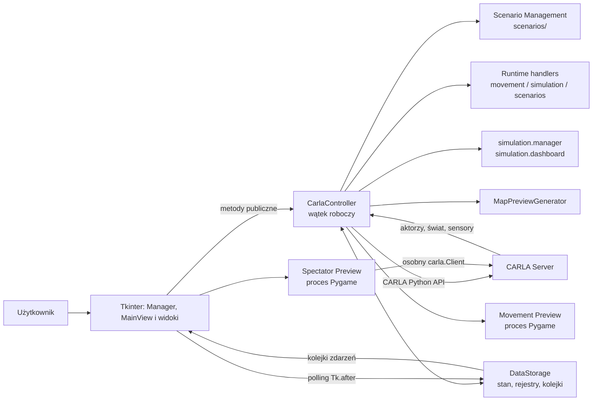

# Architektura CARLA Simulator Manager

## Zakres dokumentu

Dokument opisuje stan kodu źródłowego z 7 listopada 2026 r. Jego źródłem jest implementacja, a nie wcześniejsze raporty. Szczegóły modułów, komunikacji i danych znajdują się odpowiednio w [MODULES.md](MODULES.md), [CARLA_COMMUNICATION.md](CARLA_COMMUNICATION.md), [DATA_FLOW.md](DATA_FLOW.md) i [FEATURES.md](FEATURES.md).

## Cel aplikacji

CARLA Simulator Manager jest desktopową aplikacją administracyjną dla symulatora CARLA. Udostępnia interfejs Tkinter do:

- łączenia się z serwerem CARLA i synchronizacji bieżącego świata;
- zmiany mapy, pogody i ustawień symulacji;
- tworzenia, edycji i usuwania pojazdów, pieszych, obiektów statycznych i sensorów;
- sterowania ruchem aktorów oraz podglądu kamer;
- monitorowania aktorów, sensorów i stanu aplikacji;
- zapisywania i odtwarzania scenariuszy JSON/YAML.

Jedynym punktem wejścia jest `app.py`. Jego blok `if __name__ == "__main__"` wywołuje `multiprocessing.freeze_support()`, tworzy `gui.application.Manager` i uruchamia pętlę Tkinter przez `mainloop()`. `gui.main_view.MainView` jest głównym widokiem. Historyczny wrapper `carla_manager.py` został usunięty w etapie 4B.10.

## Technologie

| Obszar | Technologia użyta w kodzie |
|---|---|
| Język | Python |
| GUI | Tkinter/ttk |
| Symulator | CARLA Python API (`carla`) |
| Obrazy | Pillow, NumPy |
| Wykresy sensorów | Matplotlib osadzony w Tkinter |
| Okna podglądu | Pygame w procesach potomnych |
| Współbieżność | `threading`, `multiprocessing`, `queue` |
| Scenariusze | JSON ze standardowej biblioteki, YAML przez PyYAML |
| Modele danych | mutowalne modele runtime z `models.actors` oraz `dataclasses` z `models.scenarios` |

Plik `requirements.txt` deklaruje obecnie tylko PyYAML i Pillow. Kod importuje również m.in. CARLA, NumPy, Matplotlib, Pygame i Pygments; sposób ich instalacji nie jest kompletnie opisany w konfiguracji projektu.

## Ogólna architektura

Aplikacja ma architekturę warstwową w sensie odpowiedzialności, ale granice nie są ścisłe. `Manager` składa GUI i koordynuje cykl życia. `CarlaController` jest adapterem, właścicielem workera i koordynatorem operacji CARLA, a szczegółowe wykonanie deleguje do usług i trzech modułów runtime. `DataStorage` przechowuje współdzielony stan i kolejki wyników.

## Główne komponenty

### `Manager` i `MainView`

`Manager` (`gui/application.py`, `tk.Tk`) jest nadrzędnym koordynatorem GUI. Tworzy `DataStorage`, `MainView`, menedżery podglądów, inicjuje połączenie, odpytuje kolejki i zarządza rozłączeniem. `MainView` (`gui/main_view.py`) buduje główny `ttk.Notebook` z zakładkami Main View, World & Weather, Actors, Sensors i Simulation Control. Implementacje widoków znajdują się w `gui/tabs`, `gui/windows` i `gui/widgets`. Widoki zależne od świata są tworzone dopiero po połączeniu i niszczone przy rozłączeniu.

### `CarlaController`

`CarlaController` znajduje się w `core/controller.py` i uruchamia jeden wątek daemon. W nim tworzy `carla.Client`, pobiera świat i wykonuje polecenia z `command_queue` oraz `priority_command_queue`. `CommandBus` zachowuje priorytet i FIFO, a `CommandDispatcher` synchronicznie przekazuje operacje do usług World/Actors/Sensors. Handlery ruchu, ticków/dashboardu oraz scenariuszy są zdefiniowane w `MovementRuntime`, `SimulationRuntime` i `ScenarioRuntime`, z których dziedziczy kontroler. Nie są to osobne procesy ani managerowie: metody pracują na tej samej instancji i w tej samej iteracji workera.

Klasa zawiera również publiczne metody-fasady, które nie wykonują operacji bezpośrednio, lecz umieszczają komunikaty w kolejkach. Wyjątkiem od pojedynczego połączenia jest Spectator Preview, którego proces potomny tworzy własny `carla.Client`.

Usługi nie tworzą klientów ani wątków. Otrzymują mały `RuntimeContext` z klientem, store'em, bieżącym światem i biblioteką blueprintów, dlatego wszystkie delegowane RPC nadal wykonuje worker kontrolera.

### `DataStorage`

`DataStorage` z `core/state_store.py` jest współdzielonym magazynem stanu. Store zawiera:

- rejestry `Actors` i `Sensors` z `core/registries.py`, zawierające modele `ActorInfo` i `SensorInfo` z `models/actors.py`;
- referencje do `carla.World`, biblioteki blueprintów i danych świata;
- stan sterowania pojazdami i pieszymi;
- ustawienia oraz migawki symulacji;
- bufory stanu tymczasowych aktorów podglądu;
- kolejki zdarzeń dla GUI.

Obiekt nie jest trwałą bazą danych. Po rozłączeniu `Manager` tworzy nową instancję i przepina ją do `MainView`.

### Moduły domenowe

- `scenarios/` jest pakietem synchronizacji, klasyfikacji, adopcji, walidacji, zapisu, preflight, czyszczenia i odtwarzania scenariusza.
- `movement.runtime`, `simulation.runtime` i `scenarios.runtime` zawierają wykonawcze handlery dawniej zdefiniowane bezpośrednio w `CarlaController`; kontroler zachowuje stabilne publiczne API i routing.
- `simulation.manager` implementuje maszynę stanów sterowania tickami i walidację `WorldSettings`, a `simulation.dashboard` buduje okresowe migawki monitoringu.
- `movement.session` koordynuje jedną sesję Movement Control i otrzymuje fabrykę okna z `Manager`; nie importuje konkretnego widoku. Modele i logika liściowa pozostają w `movement.vehicle`, `movement.walker` i `movement.destination`.
- `preview.movement` zawiera proces Pygame, publikację ramek oraz wygładzanie sterowania manualnego.
- `preview.spectator` i `preview.spectator_controls` realizują niezależne okno obserwatora z własnym klientem CARLA.
- `preview.sensor_buffers` przechowuje thread-safe migawki sensorów bez Tkinter; okna odświeżające widgety znajdują się w `gui.windows.sensor_preview`.
- `preview.map` generuje i buforuje obrazy OpenDRIVE; nowe pliki trafiają do `resources/maps/generated/`, a dotychczasowy `images/maps/generated/` jest odczytywany jako lokalizacja zgodności. Dostarczane obrazy znajdują się w `resources/maps/bundled/`.

## Relacja GUI — kontroler — serwer

1. Callback Tkinter wywołuje publiczną metodę `Manager` lub `CarlaController`.
2. `CarlaController` zapisuje polecenie jako parę `(nazwa, dane)` do kolejki.
3. Wątek kontrolera wykonuje operację CARLA i aktualizuje `DataStorage`.
4. Wynik trafia do jednej z kolejek zdarzeń albo do pola stanu.
5. `Manager` i widoki odpytują kolejki przez `after(...)` i aktualizują widgety w głównym wątku Tkinter.

Callbacki sensorów CARLA nie modyfikują widgetów. Zapisują dane do buforów chronionych blokadami, a okna Tkinter pobierają migawki cyklicznie. Szczegóły i wyjątki opisuje [CARLA_COMMUNICATION.md](CARLA_COMMUNICATION.md).

## Najważniejsze założenia wynikające z kodu

- Stan świata CARLA jest nadrzędny dla danych runtime; lokalne rejestry są synchronizowaną projekcją wzbogaconą o metadane GUI.
- Operacje mutujące scenariusz są serializowane przez `scenario_operation_lock` i flagi operacji oczekującej.
- Aktorzy mają rozróżnienie `managed`/`external`; operacje mutujące zwykle wymagają aktora zarządzanego.
- Runtime ID aktora nie jest tożsamością trwałą scenariusza; zapis używa `scenario_id`.
- Zmiana świata unieważnia referencje runtime, stan ruchu, podglądy i plany preflight.
- Tkinter powinien być aktualizowany wyłącznie z głównego wątku przez polling kolejek.
- Podglądy Pygame są izolowane procesami uruchamianymi metodą `spawn`.
- Scenariusz jest walidowany przed zapisem i przed wykonaniem odczytu; zapis jest atomowy.

## Granice dokumentacji

Nie uruchamiano serwera CARLA ani rzeczywistego GUI. Po usunięciu warstwy legacy w etapie 4B.10 zestaw obejmuje 316 testów bez serwera; wynik bieżącej regresji i probe `multiprocessing.spawn` opisano w dokumentacji testów. Historyczne założenia i uzasadnienia, których nie można potwierdzić kodem, zachowano w [`legacy/`](legacy/) do ręcznego przeglądu; nie są one źródłem prawdy o bieżącej implementacji.
